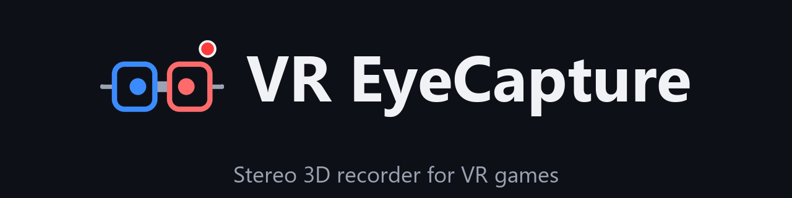
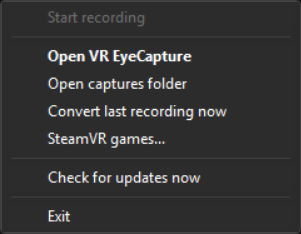
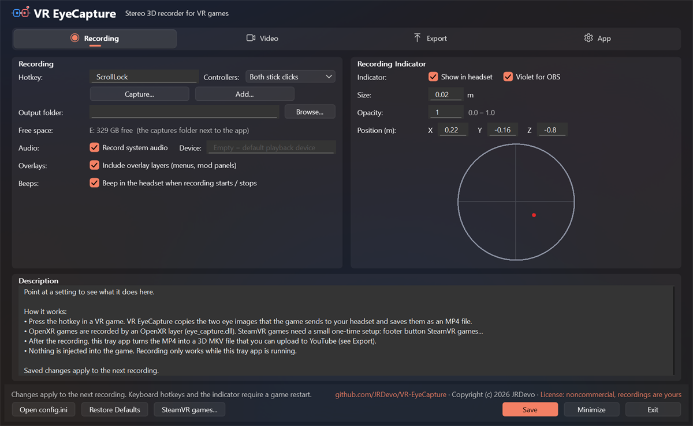
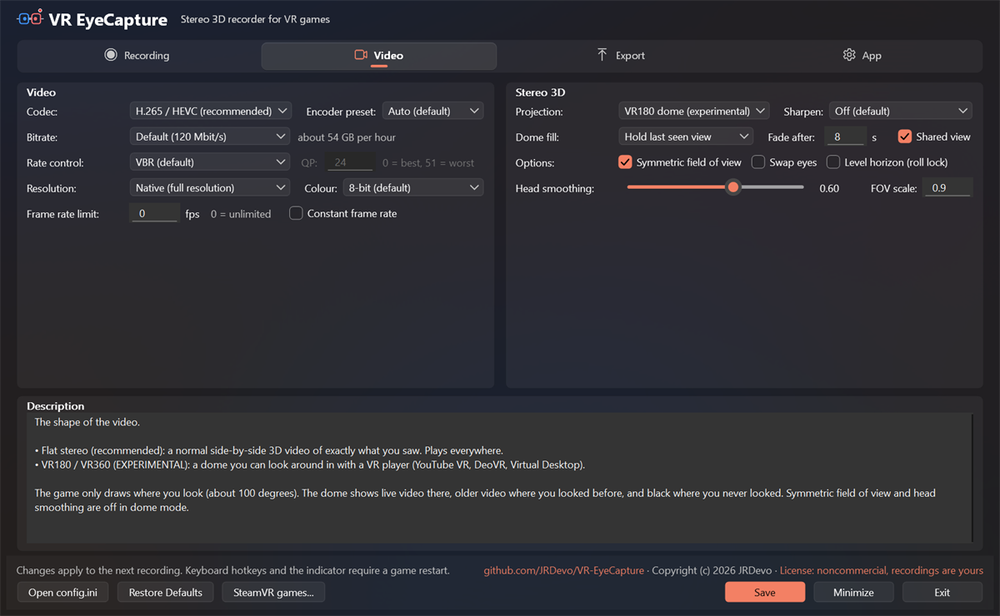
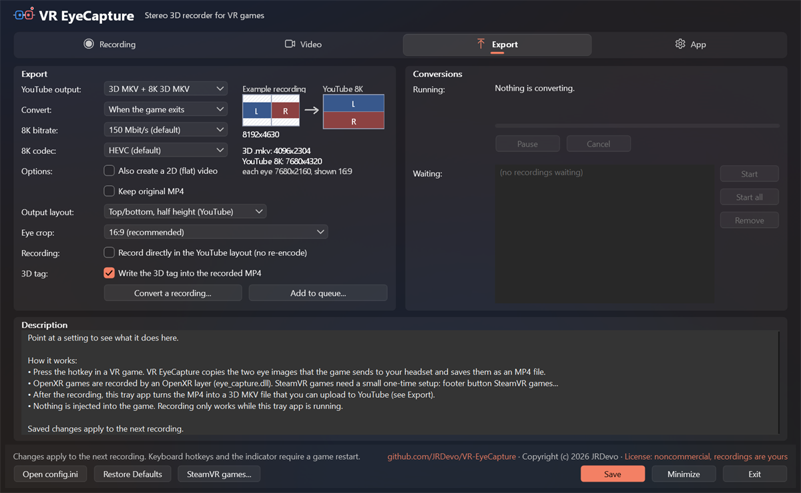
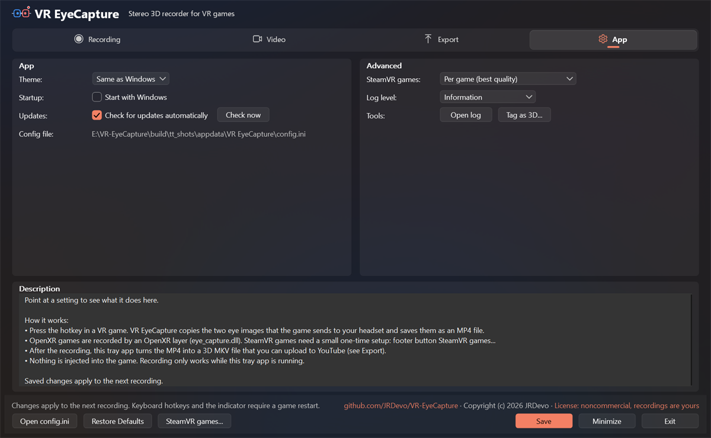
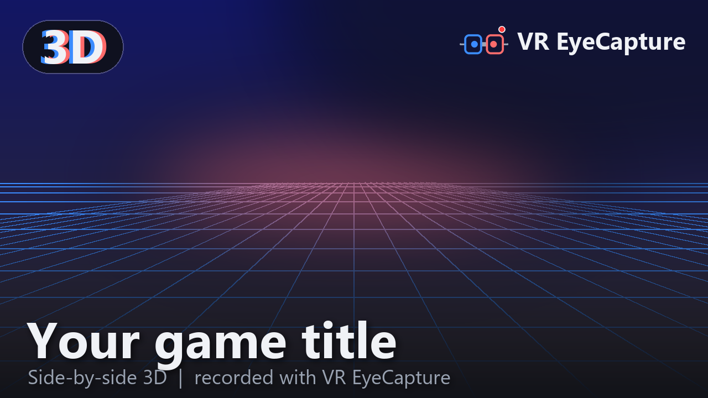
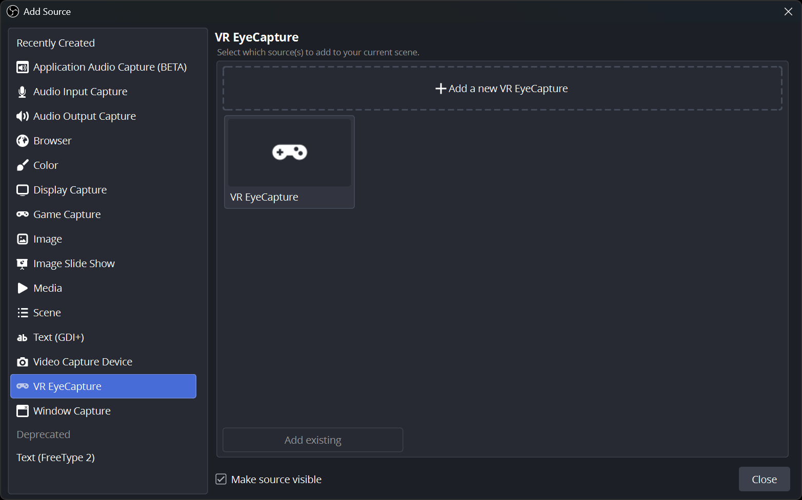
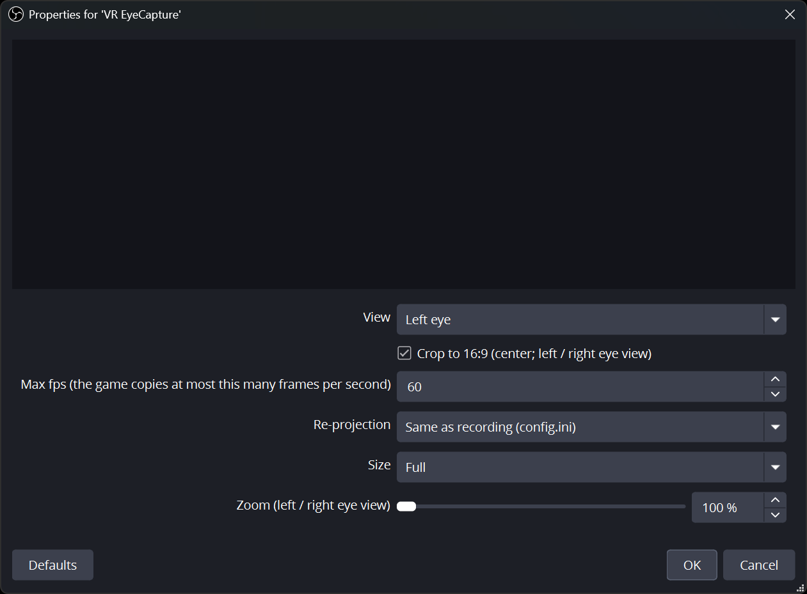
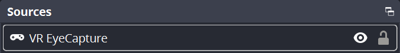

> [!CAUTION]
> ## THIS GITHUB PAGE IS THE ONLY PLACE THIS TOOL EXISTS
> **`https://github.com/JRDevo/VR-EyeCapture` is the only source of truth for this tool: the only place it is
> published, the only place it is documented, and the only place to download it (its [Releases](https://github.com/JRDevo/VR-EyeCapture/releases) page).**
>
> - There is **no website** for this tool. There **never will be** one. No Discord, no Patreon, no Nexus, no Steam Workshop, no app store.
> - **DO NOT DOWNLOAD THIS TOOL FROM ANYWHERE ELSE.** Any other site, mirror, "launcher", "installer", video link or forum attachment that
>   offers it is not mine and may carry anything. If it did not come from this GitHub page, do not run it.
> - Updates, release notes, the hotkey and settings reference and the troubleshooting guide live here and only here. If someone tells you
>   to get the tool somewhere else, they are wrong.

# VR EyeCapture — stereo 3D recorder for VR games

Records **both eye images** of a VR game (OpenXR games, and SteamVR / OpenVR games), at exactly the resolution and
quality the headset receives, into a
**side-by-side (left | right) 3D MP4** with the game's audio. Press a hotkey (or use the tray icon) to start and stop.
The MP4 carries the standard stereo flag (`st3d`, left-right) for 3D players; for YouTube the tray app also converts each
recording to a `.mkv` with the Matroska stereo tag, which YouTube reliably recognises as 3D (see "Upload to YouTube") --
automatically, or only when you say so (`post_when = manual`).

For OpenXR games it is an **OpenXR API layer**: it sits between the game and the OpenXR runtime, so it works the same
with Virtual Desktop (VDXR), SteamVR, Oculus / Meta Link, or any other runtime. Nothing is injected into the game and no
game files are touched. Games that use SteamVR's own API (OpenVR) are recorded through a copy of `openvr_api.dll` that
the tray puts into that one game's folder ([SteamVR games](#steamvr-games-virtual-desktop--steamvr)).

(The project was called **OpenXR-EyeCapture** until v0.4; the GitHub address of the old name still leads here.)

First tested target: **Euro Truck Simulator 2 / American Truck Simulator** (OpenXR beta, Direct3D 11) on Virtual
Desktop. Any other OpenXR game that renders with Direct3D 11 or Direct3D 12 should work the same way; SteamVR (OpenVR)
games with Direct3D 11 or Direct3D 12.

**In short:** a free **VR recorder** for Windows. It captures **stereoscopic 3D (side-by-side / SBS) gameplay** from a **Meta Quest 3** (Virtual Desktop or Link), a **SteamVR** headset or any other OpenXR runtime, straight from the game's own eye buffers, and prepares **YouTube 3D / VR180 uploads**. Any Direct3D 11 / 12 OpenXR game, and Direct3D 11 / 12 SteamVR (OpenVR) games.

**Menu:** [Features](#features) · [What it looks like](#what-it-looks-like) · [Download](#-download) · [Requirements](#requirements) · [Install](#install) · [How it works](#how-it-works-start-the-tray-app-first) · [Record](#record) · [YouTube](#upload-to-youtube) · [Settings](#settings--configini) · [Updates](#updates) · [Indicator](#in-headset-indicator) · [Smoothing](#head-motion-smoothing) · [Dome mode](#vr180--vr360-dome-mode-experimental) · [OBS](#live-view-in-obs-experimental) · [SteamVR games](#steamvr-games-virtual-desktop--steamvr) · [Troubleshooting](#log-and-troubleshooting) · [Cost](#cost) · [With other mods](#with-other-mods) · [Report a problem](#reporting-a-problem-what-to-upload) · [License](#license-and-credits)

## Features

- **Both eyes, exact quality** — records each eye at the exact resolution and quality the headset receives, into a
  side-by-side 3D MP4 with the game's audio.
- **OpenXR API layer** — works with any runtime (Virtual Desktop VDXR, SteamVR, Oculus / Meta Link); nothing is injected
  and no game files are touched.
- **Direct3D 11 and 12 games** — any OpenXR game that renders with either.
- **32-bit OpenXR games too** (Direct3D 11) — e.g. an old 32-bit game with a VR mod: the encoder runs in a separate 64-bit
  helper (`EyeCaptureRecorder.exe`, started by the tray), so the game's 2 GB address space stays free
  ([32-bit games](#32-bit-openxr-games)).
- **SteamVR (OpenVR) games** — tray menu **SteamVR games...** enables recording per game (Direct3D 11 and 12).
- **One hotkey** — default `ScrollLock`, or the tray icon, starts and stops a recording; beeps in the headset confirm
  (`beeps = 0` turns them off, e.g. when they end up in the recorded audio).
  It can be any key, a mouse side button, an Xbox controller button or a wheel / joystick button (or several of them).
- **VR controller hotkey** — in OpenXR and SteamVR games, hold **both thumbstick clicks for 1 s** to start / stop (the
  controllers vibrate); works in games without keyboard support, the game keeps its own buttons (`vr_hotkey`).
- **Tray app with a main window** — every option has a help text, no `config.ini` editing needed.
- **One-click registration** — the tray registers the layer for you (one UAC prompt); **Register** / **Unregister** are in the app window (Advanced > Tools).
- **Tray menu** — short, in the app's light / dark theme: Start / Stop recording, Open VR EyeCapture, Open captures folder,
  Convert last recording now, SteamVR games..., Exit, and Pause / Resume / Cancel conversion (with its progress and time
  left) while one runs. Everything else is in the app window.
- **Tray icon** — the goggles logo, one fixed icon (since 0.5.1 it no longer changes colour or blinks). Hover it: the
  tooltip shows the status, game, resolution, fps, dropped frames and elapsed time. In the headset the recording dot shows
  the state; balloons tell you about the important events (for example a failed recording or a file ready for YouTube).
- **Start with Windows** — optional, off by default (app window → Advanced).
- **Command line** — `--start | --stop | --toggle | --status` for scripts and Stream Deck buttons.
- **Automatic MKV conversion** — with the Matroska 3D tag that YouTube recognises. By default it waits until the game has
  closed, so converting never costs frame rate while you play (`post_when`: right away / when VR stops / when the game closes /
  only when you say so). The app window shows the running conversion and the waiting ones (each with its format), with
  Pause, Cancel, Start, Start all and Remove. **Add to queue...** queues recordings that wait until you start them, each
  with the Export settings shown at that moment, so one recording can be queued several times (16:9 and 4:3, HEVC and AV1).
  The queue is kept when the tray app closes.
- **Optional 8K YouTube copy** (`post_yt8k`) — a far sharper 3D picture on YouTube.
- **Optional flat 2D copy** (`post_flat`) — for viewers without a headset.
- **Head-motion smoothing and symmetric view** — for comfortable 3D.
- **In-headset recording dot** — never appears in the video.
- **Records overlay panels too** (`record_overlays`, on by default) — menus and mod panels the game shows as separate
  OpenXR layers (e.g. the DLAA injector's VR panel and fps box) are placed and blended into the video the way the headset
  shows them. The headset's own menus (Virtual Desktop, Quest) cannot be recorded.
- **VR180 / VR360 dome mode** — experimental. **Shared view** (on by default) keeps the one-eye strips at the sides out of the video, so it is easy on the eyes; clear it for the wider picture.
- **Live view in OBS** — experimental. An OBS source shows the game's eye picture live, for streaming. Stream and record at the same time. See "Live view in OBS".
- **Config changes apply to the next recording** — no game restart.
- **Hardware HEVC encoding** — NVIDIA GTX 10xx or newer, AMD RX 400 or newer, Intel 7th gen or newer.
- **Rate control and encoder preset** — VBR (default), CBR or constant QP (`rate_control`, `qp`), and the encoder's
  speed / quality preset (`quality_vs_speed`).
- **10-bit video** (`bit_depth = 10`) — HEVC Main10 / AV1 10-bit: no colour banding in skies, fog and dark scenes.
- **Sharpen** (`sharpen`) — a contrast-adaptive sharpen pass while recording, per eye; most useful for VR180 / VR360.
- **Constant frame rate for video editors** (`constant_frame_rate`) — one frame per frame period with equal durations, for
  DaVinci Resolve and other editors that dislike variable frame rate; off by default (the real frame times are kept).
- **Dormant unless the tray runs** — the layer does nothing while the tray app is not running.
- **Works alongside the [ETS2 / ATS DLAA + DLSS injector mod](https://github.com/JRDevo/ETS2-ATS-DLAA-DLSS-Injection-Mod)**.
- **Log for bug reports** — `eye_capture.log` and `tray.log` in `%LOCALAPPDATA%\VR EyeCapture\logs`.

## Examples

Recordings made with this tool, uploaded to YouTube as 3D. Watch them in the YouTube VR app on a headset (they play in
YouTube's 8K tier), or press the 3D button in the browser player. All are side-by-side recordings converted by the tray to
the top/bottom 8K 3D MKV (`Eye crop` is the Export setting that shapes each eye, see "Upload to YouTube").

### Eye crop 16:9 (8K, AV1)

The default: a wide view, 7680 x 4320, plays everywhere.

- [SynthRiders](https://www.youtube.com/watch?v=INFhu5OHPJU)
- [Pistol Whip](https://www.youtube.com/watch?v=rUvnbBKB978)
- [Beat Saber](https://www.youtube.com/watch?v=Wd_0M0jCJME)

### Eye crop 4:3 (AV1)

The taller view (more of the headset picture, 5760 x 4320). Compare it with the 16:9 Beat Saber video above; more games follow.

- [Beat Saber](https://www.youtube.com/watch?v=3QQl85dTIOg)

### Eye crop 4:3 padded (8K, AV1)

The 4:3 view with black bars left and right, 7680 x 4320, so it still gets YouTube's 8K tier.

- [Beat Saber](https://www.youtube.com/watch?v=551ydiLWmR8)

### No eye crop (full eye, AV1)

The whole eye picture, nothing cut (4320 x 4884, taller than wide). YouTube gives such a tall video a lower quality
tier than 8K, so it looks clearly softer, also on a Quest 3. Tall videos can also crash the Quest YouTube player. For
YouTube, use 16:9 or 4:3 padded.

- [Beat Saber](https://www.youtube.com/watch?v=xB8t422wg9M)

## What it looks like

Everything runs from one small icon in the Windows tray (next to the clock): the goggles logo. The icon itself does not
change (since 0.5.1). Hover it for the state and the details: no VR game, ready, recording, starting, finishing the file
or an error, converting a finished recording (game, resolution, fps, dropped frames, recording time, conversion
progress). In the headset, the small recording dot shows the state too. **Left-click** the icon to open the app window (with the
conversion queue); **right-click** it for the menu.

### The tray menu (right-click the icon)

| Item | What it does |
|---|---|
| *Converting <file> (8K) 42% - about 6 min left* | Shown greyed at the top while a conversion runs: the file, the step (MKV, flat or 8K), how far that step is and roughly how long it still takes (paused time is not counted). |
| **Pause conversion** / **Resume conversion** | Only while a conversion runs. Pauses the running ffmpeg (it uses no CPU / GPU while paused; the tooltip says "paused") and continues it later. |
| **Cancel conversion** | Only while a conversion runs. Stops it and deletes the half-written file of that step (`<name>.part`). The MP4 is always kept (even with `keep_mp4 = 0`), files finished earlier in the same conversion stay, and recordings waiting behind it still convert. A balloon says "Conversion cancelled: <file>". |
| **Start recording** / **Stop recording** | Starts or stops a recording in the running VR game. Same as your hotkey (shown next to it). Greyed out while no game is running. |
| **Open captures folder** | Opens the folder with your recordings (`Videos\VR EyeCapture` unless you set another one). |
| **Convert last recording now** | Converts the newest recording at once (the YouTube `.mkv`, the 8K copy, the flat copy, whatever you switched on), even if conversion is set to wait until the game closes or to "When I say". |
| **Open VR EyeCapture** (bold; same as left-click) | Opens the app window (below). |
| *(moved to the app window)* | **Convert a recording...** (Export group), **Open config.ini** (footer), and in Advanced > **Tools:** **Open log**, **Tag as 3D...** (side by side / top / bottom: copies a video made elsewhere, e.g. an OBS recording, into `<name>_3D.mkv` with the 3D tag YouTube reads, without re-encoding), **Register for VR games...** / **Unregister from VR games...** (one administrator prompt; needed once, the installer does it). |
| **SteamVR games...** | The SteamVR (OpenVR) games in your Steam library, each with a check box: tick to record it, untick to undo; **Enable all**, **Add a game by exe...** for other games ([SteamVR games](#steamvr-games-virtual-desktop--steamvr)). |
| **Update to vX.Y.Z...** | Shown only when a newer version is on GitHub. Asks to confirm, then downloads the installer (its checksum is verified) and runs it; you see the normal Windows (UAC) prompt and the setup replaces the app and keeps your settings. See [Updates](#updates). |
| **Check for updates now** | Checks GitHub for a newer version right away (nothing is downloaded by this). |
| **Exit** | Closes the tray app. Games started after that are not recorded. A running conversion is cancelled (its half-written file is deleted) and a waiting one is dropped; the MP4 stays. |

### The app window (left-click the tray icon)

The settings are on four tabs: **Recording**, **Video**, **Export** and **App**. Each tab has two groups.

| Recording tab | Video tab |
|---|---|
|  |  |
| **Export tab** | **App tab** |
|  |  |

*(Dark theme shown. The window follows the Windows light / dark setting unless you pick one under Theme. The Video tab is
shown with Projection = VR180, so the dome settings are not greyed.)*

Point at any setting and the **Description** box at the bottom explains it. **Save** applies to the next recording. Drag an edge or corner to resize the window (the Description box takes the extra room); if the window is taller than the screen, its content scrolls and the buttons stay at the bottom.

| Tab: group | What is in it |
|---|---|
| Recording: **Recording** | **Hotkey**: the key that starts / stops a recording; on the same line **Controllers**: the VR controller buttons that do the same when held together for 1 s (Both stick clicks, X + A, Y + B, Menu + right stick click, Off; a combination set in config.ini shows as Custom). **Capture...** records a key, mouse button, Xbox controller button or wheel button for you; **Add...** adds a further one. **Output folder** (**Browse...** picks a folder on any drive; the line below shows that drive's free space, e.g. "E: 812 GB free"). **Audio** (record system audio, and on the same line the **Device** to record; empty = the default playback device). **Overlays**: include overlay layers (menus, mod panels) in the video. **Beeps**: beep in the headset when a recording starts / stops (clear it if the beeps are heard in your recordings). |
| Recording: **Recording Indicator** | A small red dot that you see in the headset while recording, never in the video. Size, opacity and where it floats (X / Y / Z). **Click or drag in the round preview** to put the dot there; the **mouse wheel** over it moves the dot nearer / farther. **Violet for OBS**: the dot turns violet while OBS shows the live view and nothing is recorded (`indicator_live`). |
| Video: **Video** | **Codec** (H.265 / HEVC is recommended; AV1 needs a GPU with an AV1 encoder, e.g. NVIDIA RTX 40 / 50, and falls back to HEVC without one) and, on the same line, the **Encoder preset** (Auto, Fastest, Fast, Balanced, Quality, Best quality: `quality_vs_speed`). **Bitrate**: Default (120 Mbit/s), 150, 200, 250, 300, 350, 400, 450 or 500 Mbit/s, with the file size per hour next to it (250 Mbit/s = about 113 GB per hour; suggested: 250 at 60 fps, 120 at 30 fps, 350 - 500 for VR180 / VR360 on a fast GPU; a value set in config.ini shows as Custom; greyed for Constant QP). **Rate control**: VBR (default), CBR or Constant QP, with the **QP** field (0 = best, 51 = worst; only for Constant QP). **Resolution**: Native, 3840 px (4K), 2560 px (2K) or 1920 px (1080p) -- the width of the whole side-by-side video; smaller = less GPU work while recording and smaller files; on the same line **Colour**: 8-bit (default) or 10-bit (`bit_depth`; HEVC / AV1, no colour banding). **Frame rate limit** in fps (0 = unlimited, the game's own rate) and **Constant frame rate** (for video editors such as DaVinci Resolve). |
| Video: **Stereo 3D** | **Projection**: flat stereo (side by side, normal) or the experimental VR180 / VR360 dome; on the same line **Sharpen**: Off, Light, Medium or Strong (`sharpen`). **Dome fill**, **Fade after** and **Shared view**: dome mode only (greyed while Projection is Flat). **Shared view** (`dome_shared_view`, on by default): each eye shows only what the other eye also sees, so there are no one-eye strips at the sides (easy on the eyes); clear it for a wider picture (on a Quest 3 about 14 degrees more on each outer side), where only one eye sees the outer strips. **Options**: *Symmetric field of view* lines both eyes up so the 3D is comfortable (leave on), *Swap eyes* if left and right look swapped, *Level horizon (roll lock)* keeps the horizon level. **Head smoothing**: calms small head shakes (0 = off), with the **FOV scale** (field of view scale) next to it: zooms in a little to hide the edges. |
| Export: **Export** | **YouTube output**: the plain 3D MKV, the sharper 8K 3D MKV (slower to make), both, or none. **8K bitrate**: 100, 150 (default) or 200 Mbit/s for the 8K file (NVIDIA encoder). **8K codec**: HEVC (default) or AV1 (RTX 40 / 50; sharper at the same bitrate, falls back to HEVC). **Convert**: immediately, when the VR session ends, when the game exits (so it does not cost frame rate while you play), or *When I say* (never on its own). **Convert a recording...**: pick MP4s to convert next. **Add to queue...**: pick MP4s that wait in the Conversions list until you click Start / Start all. Both use the Export settings the window shows at that moment (saved or not) for those files. **Also create a 2D (flat) video** for people without a headset. **Keep original MP4**. **Output layout**: how the two eyes are packed for YouTube (top/bottom, half height is what YouTube likes; greyed for VR180 / VR360). **Eye crop**: 16:9 widescreen (recommended; plays in the Quest YouTube app and gets 8K), 4:3 (taller view), 4:3 padded to 16:9 (the taller view with black side bars, 7680x4320 so it still gets 8K) or none (full eye, but tall videos may crash the Quest YouTube player). **Record directly in the YouTube layout (no re-encode)** (`record_for_youtube`): the recording itself is made in that output layout and eye crop at the 8K size, so the tray only copies it into the `.mkv` (seconds) and that `.mkv` is the upload; the 8K bitrate / codec are greyed then (no separate 8K file), and the full side-by-side picture is not kept. Flat projection only. **3D tag: Write the 3D tag into the recorded MP4** (`tag_3d`, on by default): clear it for a plain MP4 that video editors such as DaVinci Resolve open more easily; the 3D MKV still gets its own tag, and **Tag as 3D...** adds the tag later. |
| Export: **Conversions** | Live view of the conversion queue (refreshes twice a second). **Running**: the file, its format, the step (MKV, flat or 8K), percent, time left, or why it waits; a progress bar; **Pause** / **Resume** and **Cancel** (when the running conversion waits for the Convert setting, Pause reads **Run now** and starts it). **Waiting**: the conversions in the order they run, each as `<file> - <format> - <state>`, e.g. `rec.mp4 - 8K AV1 100M, 4:3, tb_half - waiting for you`. States: *next*, *waiting for you* (added with Add to queue, or restored after a restart: waits for Start), *waiting: converts when the game closes* (the Convert setting), *queued*. Automatic recordings show *(current settings)*: they use the saved settings as they are when their conversion starts. Select one or several (Ctrl / Shift) and click **Start** (they run next, in order), **Start all** (every waiting one, in list order), or **Remove** (the MP4 stays). The list is saved in `queue.json` (in `%LOCALAPPDATA%\VR EyeCapture`); after a restart every entry comes back as *waiting for you*. |
| App: **App** | **Theme**: **Same as Windows** (default), **Light** or **Dark**, for this window, the SteamVR games window and the tray menu (`theme` in `config.ini`; applies on Save). **Startup**: **Start with Windows** (starts the tray app when you log in). **Updates**: check GitHub for a newer version automatically (see [Updates](#updates)), with a **Check now** button; when one is found, a line at the top of the window offers to update. **Config file**: the `config.ini` this window edits. |
| App: **Advanced** | **SteamVR games**: how SteamVR games are recorded (per game, quick mode or off; the same setting as in the SteamVR games window). **Log level** (how much goes into the log). **Tools**: **Open log**, **Tag as 3D...** (and **Register for VR games...** when the layer is not registered). |
| Buttons | **Open config.ini**, **Restore Defaults** (fills in the defaults, nothing saved until Save), **SteamVR games...**, **Save** (saves; the window stays open), **Minimize**, **Exit** (closes the window; asks first when there are unsaved changes; the tray keeps running). The window has no title bar: drag it by the header (the logo row) or the free space at the bottom. The window remembers the last tab while the tray runs. |
| Footer | **github.com/JRDevo/VR-EyeCapture** opens this page. **License: noncommercial, recordings are yours** opens [`LICENSE.md`](LICENSE.md); point at it for the short version: the tool is free for noncommercial use, your recordings are yours and you may earn money from them, and the tool itself must not be sold. |

## ⬇ Download

**[Download the latest release here](https://github.com/JRDevo/VR-EyeCapture/releases/latest)**
— get `VR-EyeCapture-Setup-v<version>.exe` under **Assets**, then follow [Install](#install) below.
(The green **Code** button holds only this page and the OBS plugin source, not the tool.)

This is an unofficial fan project. It is not affiliated with, or endorsed by, SCS Software, The Khronos Group, Meta,
Valve or Virtual Desktop Inc. Euro Truck Simulator 2 and American Truck Simulator are trademarks of SCS Software;
OpenXR is a trademark of The Khronos Group.

## Requirements

- Windows 10 (1703 or newer) or Windows 11, 64-bit.
- An OpenXR game using **Direct3D 11 or Direct3D 12**, or a SteamVR (OpenVR) game using **Direct3D 11 or Direct3D 12**. Vulkan is planned;
  OpenGL is not supported. Unsupported games run normally, just without recording.
- **32-bit OpenXR games** (a 32-bit game, or a 32-bit VR mod of an old game, through the 32-bit OpenXR loader): **Direct3D 11**
  only, with a 32-bit OpenXR runtime (e.g. Virtual Desktop's VDXR, which ships one). They are recorded through
  `eye_capture32.dll` + the 64-bit helper `EyeCaptureRecorder.exe` (both installed and registered by the setup; see
  [32-bit OpenXR games](#32-bit-openxr-games)).
- A GPU with a hardware HEVC (H.265) encoder: NVIDIA GTX 10xx or newer, AMD RX 400 or newer, Intel 7th gen or newer.
  HEVC is needed for wide frames: a Quest 3 at high settings is about 6000 x 3200 side by side, beyond H.264 limits.
  Optional: `codec = av1` records AV1 on GPUs with a hardware AV1 encoder (NVIDIA RTX 40 / 50 series; tested on an RTX 5090:
  8192 x 4348 at 90 fps with no dropped frames).

## Install

1. Run `VR-EyeCapture-Setup-v<version>.exe` and accept the one Windows administrator (UAC) prompt. It installs into
   `C:\Program Files\VR EyeCapture` (you can pick another folder), adds a Start menu entry and registers the layer for all
   OpenXR apps: `HKLM\SOFTWARE\Khronos\OpenXR\1\ApiLayers\Implicit\<folder>\XR_APILAYER_JRDEVO_eye_capture.json = 0`
   (any older registration from another folder is replaced), and for 32-bit OpenXR games the 32-bit layer in the 32-bit
   registry view: `HKLM\SOFTWARE\WOW6432Node\Khronos\OpenXR\1\ApiLayers\Implicit\<folder>\XR_APILAYER_JRDEVO_eye_capture32.json = 0`.
2. At the end, leave **Start VR EyeCapture now** ticked: the tray icon appears. Later: Start menu → **VR EyeCapture**.
   The program folder stays read-only; your data lives in your own folders: settings in
   `%APPDATA%\VR EyeCapture\config.ini`, logs in `%LOCALAPPDATA%\VR EyeCapture\logs`, recordings in
   `Videos\VR EyeCapture` (unless you pick another output folder).
3. Optional: tick **Start with Windows** in the app window → Advanced so the tray app always runs (it must run before the
   game, see "How it works"). This writes one Run entry for your Windows account (`HKCU\Software\Microsoft\Windows\CurrentVersion\Run`,
   value `VR EyeCapture`; Task Manager > Startup apps lists it as "VR EyeCapture"). Your choice is also saved in config.ini
   (`start_with_windows = 1`): if the entry later goes missing (a cleaner or antivirus removed it) or points to an old folder,
   the tray puts it back at its next start. An entry you switched off in Task Manager stays off. Without that key (a config
   from before 0.5.0) the tray only reads the entry: one pointing to another folder is reported once (one notification),
   and your own click replaces it (untick and tick **Start with Windows** again).
4. SteamVR (OpenVR) games need one more step: tray menu → **SteamVR games...** → tick the games
   ([SteamVR games](#steamvr-games-virtual-desktop--steamvr)).

Updating: run the new setup; it closes the tray app, replaces the program and keeps your settings and recordings. From
OpenXR-EyeCapture (v0.4 or older, a zip folder): your settings in `%APPDATA%\OpenXR-EyeCapture\config.ini` are copied to
`%APPDATA%\VR EyeCapture\config.ini` at the first start (the old file is left alone); then delete the old folder (its
registration is replaced by the setup).

Uninstall: Windows Settings → Apps → **VR EyeCapture** → Uninstall, or tray menu → **Remove VR EyeCapture from this PC...**
(the same). It closes the tray app, puts the original `openvr_api.dll` back in every SteamVR game you enabled (close those
games and SteamVR first), removes the layer registration, the Start with Windows entry and the `HKCU\Software\OpenXR-EyeCapture`
value `Home`, deletes the program, and then asks twice (No is the default): delete your settings and logs? delete your
recordings in `Videos\VR EyeCapture`? Nothing else is left behind.

Command-line forms (from an administrator prompt): `EyeCaptureTray.exe --register` / `--unregister` (exit code 0 = done,
5 = no administrator rights; both do the 64-bit and the 32-bit layer); `EyeCaptureTray.exe --status` prints `registered=yes|no|stale`
(both layers), `registered32=yes|no|stale|nofiles` (the 32-bit layer alone) and `autostart=yes|no` among the status fields;
`--quit` closes the running tray app of that folder and `--uninstall-cleanup` does the uninstaller's clean-up (both used by the setup).

## Updates

The tray app can tell you when a newer version is on the [Releases](https://github.com/JRDevo/VR-EyeCapture/releases) page,
and update you with one click.

- **Automatic check** (on by default; `check_updates = 1`, app window → Recording → **Updates**): a few seconds after the
  tray app starts, and then at most once a day while it runs, it makes one HTTPS request to
  `api.github.com/repos/JRDevo/VR-EyeCapture/releases/latest`. It only *reads* the latest release; nothing is downloaded.
  Any failure is silent and only noted in `logs\tray.log`. Drafts and pre-releases are ignored. Turn it off with the
  checkbox (or `check_updates = 0`); **Check for updates now** (tray menu) and **Check now** (app window) still work.
- **When a newer version is found:** one tray balloon ("VR EyeCapture vX.Y.Z is available"), an **Update to vX.Y.Z...** item
  in the tray menu, and a line at the top of the app window. The balloon appears once per version (it is remembered in a
  small file next to the logs, never in the registry).
- **Updating** happens only when **you** click. The app asks you to confirm (with a link to the release notes), then
  downloads `VR-EyeCapture-Setup-v<version>.exe` from GitHub into `%TEMP%\VR-EyeCapture-update\`, **verifies its SHA-256
  checksum** against the one GitHub publishes for the asset (if the checksum is missing or does not match, the file is
  deleted and nothing is run), and starts the installer. You see the normal Windows (UAC) prompt; the setup closes the tray,
  replaces the program and keeps your settings and recordings. Downloads come only from `github.com` /
  `*.githubusercontent.com` over HTTPS.
- You can always skip all of this and just download the installer yourself from the
  [Releases](https://github.com/JRDevo/VR-EyeCapture/releases) page.

## How it works: start the tray app first

**Start `EyeCaptureTray.exe` before launching the game. Without it the recorder does nothing** (it is dormant: every
OpenXR / OpenVR call is passed straight through, no hotkey, no recorder, no encoder, no shared memory). While the tray app runs it
holds a small marker object (`Local\OpenXR-EyeCapture-TrayAlive`); the layer looks for it when the game creates its VR
session and arms itself only if it is there. The decision is made once per session, so starting the tray after the game
is already in VR does not arm it: restart the game (or its VR session). Closing the tray while a game is already armed
does not stop the layer; the hotkey keeps working until the game ends.
Set `require_tray = 0` in `config.ini` to always arm without the tray (old behaviour, hotkey only).
The tray app also owns the registration: at start it checks that the layer is registered for its own folder (and removes
any per-user HKCU copy, which would make some loaders load the layer twice) and offers to register it if not.

### 32-bit OpenXR games

A 32-bit game loads the 32-bit OpenXR loader, which only sees the 32-bit layer `eye_capture32.dll` (registered by the setup
in the 32-bit part of the registry). That layer keeps the game's side small: the hotkey, the tray icon, the beeps, the
in-headset dot and the settings work exactly as in a 64-bit game, but each eye picture is copied on the GPU into a shared
texture and the recording itself is made by **`EyeCaptureRecorder.exe`**, a 64-bit helper the tray app starts by itself
when a 32-bit game opens its VR session (and which exits with the game). So the game's limited 2 GB address space is not
used for the encoder (measured: about 6 MB more while recording), and the recordings are the same as for a 64-bit game
(symmetric view, head smoothing, dome, audio, the MKV / 8K conversions). The tray log says
`32-bit games: started ...EyeCaptureRecorder.exe ... for <game>`; the recorder writes into the same `eye_capture.log`.

- **Direct3D 11 only.** Overlay panels (`record_overlays`) and the OBS live view are not available for 32-bit games: only
  the game's two eye pictures are recorded.
- **One 32-bit game at a time.** A second one runs normally and says in the log why it is not recorded.
- If the game exits or crashes while recording, the helper still finishes the MP4 (and the tray converts it as usual).
- The tray app must run (as for every game): a hotkey press right after a 32-bit game started waits up to 8 s for the
  helper. Without it you hear the error beep and the log says `EyeCaptureRecorder.exe ... is not running`.
- A game that runs as administrator cannot be recorded by a normal tray app (Windows keeps them apart): run the game
  normally.

## Record

1. Start `EyeCaptureTray.exe`, then the game in VR as usual (ETS2 / ATS: launch option `-openxr`).
2. Press **ScrollLock** (the default hotkey) → one beep (880 Hz) in the headset: recording. **Or with the VR controllers**
   (OpenXR and SteamVR games): press both thumbsticks down and hold them for 1 second → a short vibration + the beep. The
   same again stops it (two beeps; OpenXR games: a longer vibration). See "VR controller hotkey" below.
3. Press **ScrollLock** again → two beeps: stopped, the MP4 is finalized.
   One long low beep = it could not start (see the log).
   The beeps are played by the game's own process, so you hear them wherever you hear the game (they no longer depend on
   the "System sounds" volume in the Windows volume mixer). They play on the Windows default playback device; if that is
   the device being recorded (the usual setup), they are in the recording too: set `beeps = 0` (app window: Recording -> Beeps) to switch them off.
4. The file lands in `Videos\VR EyeCapture` (or the output folder you set), named
   `<game exe>_<yyyyMMdd_HHmmss>_SBS.mp4`, e.g. `eurotrucks2_20261009_201512_SBS.mp4` (a second recording within the same
   second gets `..._2_SBS.mp4`; an existing file is never overwritten) (`_VR180.mp4` / `_VR360.mp4` in
   dome mode, see "VR180 / VR360 dome mode").

**VR controller hotkey** (`vr_hotkey`, OpenXR games, 64- and 32-bit): the layer adds its own small OpenXR action set to
the game's controller input, so it works in any OpenXR game, also one without keyboard support. Default: hold **both
thumbstick clicks** for `vr_hotkey_hold_s` = 1.0 s. The game still sees the buttons (our action set gets the same priority
as the game's set that uses them, never a higher one), and only controller profiles the game itself suggests get our
bindings, so the runtime keeps picking the profile the game expects. Other combinations: `vr_hotkey = left_menu+right_a`
(buttons `a`, `b`, `x`, `y`, `menu`, `thumbstick`, `trigger`, `grip`, prefixed `left_` / `right_`, up to 4; on Quest / Oculus
Touch there is no `right_menu`: that is the system button). `vr_hotkey = off` leaves the game's input completely alone.
The log shows the bindings (`vr hotkey: binding ... merged into the game's N bindings`), the controller profile the
runtime uses and every activation (`vr hotkey: thumbsticks held 1.0 s -> start recording`). A game with no controller
input at all gets our action set after 20 s of frames. Read when the game starts. A game that offers only the basic "simple controller"
(no thumbsticks; American Truck Simulator / Euro Truck Simulator 2) also gets the real controller types (Quest, Index, Vive,
WMR) with its own buttons translated (select = trigger, menu = menu), so the runtime uses the real controller, the game keeps
its buttons and the sticks work (log: `the game suggests only khr/simple_controller ...`).

SteamVR (OpenVR) games (since 0.5.1): a game takes one SteamVR Input action list per process, so the in-game proxy cannot
add buttons. While a SteamVR game recorded by VR EyeCapture runs, the tray starts `EyeCaptureVrInput.exe`: a small SteamVR
overlay app with its own action list ("VR EyeCapture" in SteamVR → Settings → Controllers → Manage controller bindings,
where you can also rebind it) and default bindings for Quest / Oculus Touch, Index, Vive and WMR controllers. Same
`vr_hotkey` / `vr_hotkey_hold_s`, same vibration; it exits with the game. The log shows `vr input: ...` lines.

Recording also stops and the file is finalized when the game closes its VR session (quitting the game normally).
If the game crashes or is killed while recording, the MP4 is lost (it is only finalized at the end).

**Tray icon**: one fixed goggles icon (since 0.5.1 it no longer changes colour or blinks, and the tray does no polling
while no VR game runs). Hover it for the status: no VR game / ready / recording / starting / finalizing / failed /
converting a finished recording (see "Upload to YouTube"). In the headset the recording dot shows the state.
Left-click: the app window. Right-click: Start / Stop recording, Open VR EyeCapture, Open captures folder, Convert last recording now, SteamVR games..., Exit, and while a
conversion runs Pause / Resume / Cancel conversion. The tooltip shows game, resolution, fps, dropped frames and elapsed time, and
"converting <file> (MKV) 42% - about 6 min left" / "paused: <file> ..." / "last: <file>.mkv ready". `EyeCaptureTray.exe --start | --stop | --toggle | --status` does the
same from a script or a Stream Deck button (`--start` / `--toggle` print an error if the tray app is not running);
`--status` also prints `registered=yes|no|stale` and `autostart=yes|no`. `EyeCaptureTray.exe --inputs [seconds]` lists the
Xbox controllers and wheels / joysticks the tray can see and, for 15 s (or the given seconds), prints the `hotkey` text of
every button you press.

## Upload to YouTube

**The tray app converts every recording to a `.mkv` (automatically, unless Convert is set to "When I say"); upload the `.mkv`.** YouTube only reliably recognises
the 3D tag as the Matroska `stereo_mode` tag (it ignored the MP4 `st3d` box), so when a recording is saved
the tray (it must be running, which it is anyway for the layer to be active) writes the `.mkv` with ffmpeg. The recording
itself is a full side-by-side MP4 (unless it was recorded in the YouTube layout, see below); the **Output layout** (`layout_3d`, app window: "Output layout" in the Export group) decides what
the `.mkv` contains. YouTube only handles `tb_half` correctly (it reads every 3D upload as half-format), so that is the
default: the `.mkv` is **re-encoded** (NVENC HEVC 150 Mbit/s, x265 without NVENC; same frame rate, at most 8192 on the long
side, no upscaling) with each eye squeezed to half height, left eye on top, tagged `top_bottom`. With `layout_3d = sbs_full`
the `.mkv` is the plain fast remux of the recording (`left_right`, no re-encode, takes seconds, the picture is untouched).
YouTube then processes it as a 3D video; viewers in a headset (YouTube VR) get 3D.
Processing of large files takes a while; the 3D version can appear later than the first standard-definition version.

**Frame rate:** YouTube plays at most 60 fps, and the 8K conversion makes a 60 fps video. A game frame rate that 60 divides
evenly (60, 120, 180, 240, or 30) converts cleanly; any other (72, 80, 90, 144 ...) drops frames unevenly, so the
motion stutters a little (72 -> 60 drops one frame in six). Set the headset to **120 Hz** (or 60 Hz) in Virtual Desktop
or the headset settings for smooth video. While such a game runs, the tray tooltip and the app window (next to the Export
settings) show a warning, and one balloon per game session appears when the first recording starts.

**Record for YouTube** (`record_for_youtube = 1`): the layer records straight in the YouTube layout, so no re-encode is
needed afterwards. While recording, both eyes get the symmetric view (`symmetric_fov` is switched on for that recording if
it is off), each eye is centre-cropped to `eye_crop` (16:9 by default), scaled so the frame's short side is 4320 and packed
per `layout_3d` (default `tb_half`: left eye on top, each eye half height) -- on a Quest 3 that is the 7680x4320 8K frame
the tray's 8K step would make (4:3: 5760x4320; 4:3pad: 7680x4320 with black bars beside the 4:3 picture). The MP4 gets the matching `st3d` box and a small `<name>.json` next to it
that tells the tray it is already in the upload layout. What you lose: there is no full side-by-side recording to go back
to -- the crop, the layout and the size are baked into the picture (change `eye_crop` / `layout_3d` before you record).
8K needs `codec = hevc` (default) or `av1`; with `h264` the frame is capped at 4096 wide, and `max_width` also caps it
(the whole frame is scaled down). YouTube plays at most 60 fps, so `max_fps = 60` is a good match for this mode. Flat
recordings only (VR180 / VR360 ignore it). If the game reports no usable field of view at the start, the recording is made
the normal side-by-side way (logged).

- **When** it converts is `post_when` (app window: "Convert" in the Export group). Converting re-encodes on the
  GPU / CPU, so during a game it can cost frame rate:
  - `game_exit` (default, "When the game exits"): the recording waits until the game that made it has exited and no VR
    game is running. The tooltip says "1 recording waiting -- converts when the game closes".
  - `session_end` ("When the VR session ends"): waits until no game has a VR session open (the game left VR or closed). If a VR
    session starts while a conversion runs, that ffmpeg is paused (suspended) and continues when VR stops
    ("conversion paused: <file> -- resumes when VR stops").
  - `now` ("Immediately"): as soon as the recording is saved.
  - `manual` ("When I say"): never on its own. Finished recordings wait in the queue (tooltip: "1 recording waiting --
    converts when you say"; the MP4 stays) until you start one: app window > Conversions > select it > **Start**
    (or **Start all**), or **Convert a recording...** (app window or tray menu), or **Convert last recording now**. Recordings
    that were already waiting when you switch to `manual` stay waiting; a conversion that was running pauses ("Run now"
    in the app window continues it). Switching back to another value lets the waiting ones convert by that rule.
  **Tray menu > Convert last recording now** and **Convert a recording...** always start at once (next), whatever `post_when` says.
  **app window > Add to queue...** is the opposite: those recordings always wait for **Start** / **Start all**, even with `post_when = now`.
  Exiting the tray cancels a running conversion (its partial file is deleted, the MP4 stays); the queue (with that conversion
  first) is saved in `queue.json` next to the tray app and comes back at the next start with every entry *waiting for you*
  (entries whose MP4 is gone are dropped). The files that conversion had already finished are remembered: when it runs again
  it only makes the missing ones, with the same settings, instead of making a second copy ("x (2).mkv") of the rest.
  A conversion writes each file as `<name>.part` and renames it only after it was checked, so a file with its final name is
  always complete; a `.part` left behind by a logoff, shutdown or crash is deleted when the tray starts again (or when that
  recording is converted). If the tray app crashes or is killed, its ffmpeg is ended with it.
- **Several versions of one recording**: each queued conversion carries its own format, a snapshot of the conversion
  settings (`post_mkv`, `post_yt8k`, `post_flat`, `keep_mp4`, `layout_3d`, `eye_crop`, `yt8k_codec`, `yt8k_bitrate_mbps`)
  taken when it is added: from the app window as it is shown (saved or not) for "Add to queue..." / "Convert a
  recording..." there, from `config.ini` for the tray menu's "Convert a recording...". Automatic recordings and "Convert last
  recording now" have no snapshot: they use `config.ini` as it is when the conversion starts (so a settings change while a
  recording waits for the game to close still applies). Queue the same MP4 again after changing the Export settings to get
  e.g. a 16:9 and a 4:3 copy, or an HEVC and an AV1 8K file; the same file with the same format is not queued twice. With
  `keep_mp4 = 0` the MP4 is deleted only by the last conversion that needs it (while another one for the same MP4 waits, it stays).
- While it runs the tray tooltip says "converting <file> (MKV) 42% - about 6 min left" (the percent
  needs `ffprobe`, which ships next to ffmpeg); the tray menu can pause, resume or cancel it. Afterwards the tooltip says
  "last: <file>.mkv ready" and a balloon says "Ready for YouTube: <file>.mkv". One recording at a time, in order.
- The MP4 is deleted only after the MKV is verified (`keep_mp4 = 1` keeps both): a remux must exist and be larger than 90%
  of the MP4; a re-encoded `.mkv` must exist, not be empty and (with `ffprobe`, which ships next to ffmpeg) have the MP4's
  duration within 1 s / 2%. If anything
  fails (a balloon shows the first line of ffmpeg's error) the MP4 is left untouched. **Tray menu > Convert last recording
  now** retries the most recent recording (it needs the MP4, so use `keep_mp4 = 1` if you want to be able to redo it).
- Needs ffmpeg: `winget install Gyan.FFmpeg.Essentials`. The tray finds it on `PATH`, else in the WinGet packages folder, else
  in an `ffmpeg` folder next to the tray app (or set `ffmpeg_path`). Without ffmpeg you get one balloon "ffmpeg not found"
  and the MP4 stays as it is.
- Dome recordings (`_VR180` / `_VR360`): always a plain remux (`layout_3d` does not apply), the MKV keeps the VR180 / 360
  metadata (`stereo_mode` is `top_bottom` for VR360). See "VR180 / VR360 dome mode".
- Recordings made with **Record directly in the YouTube layout** (`record_for_youtube = 1`; the recording's `<name>.json`
  says `"youtube":1` with its packing and eye crop) are already in the upload format, so the tray treats them as converted:
  the `.mkv` is always the plain remux (`-c copy`, seconds, tagged `top_bottom` / `left_right` from the sidecar) named
  `<name>.mkv` without a crop tag, whatever `layout_3d` / `eye_crop` say now (they are baked into the picture). The 8K step
  is skipped ("already in the YouTube 8K layout") and no `_YT8K` file is made; with `keep_mp4 = 0` the MP4 is deleted after
  the remux was verified. `post_flat = 1` still works: the `_FLAT.mp4` takes the left eye from the top / left part and
  un-squeezes it before the usual 16:9 crop. The balloon says "Ready for YouTube: <name>.mkv": upload that file.
- Only recordings that finish while the tray runs are converted; older ones: `scripts\make_mkv.ps1 <file.mp4>` (the manual
  path, a plain remux, so it ignores `layout_3d`) or "Convert last recording now".
- **Thumbnail:** `scripts\make_thumbnail.ps1 <recording.mp4|.mkv>` writes `<recording>_thumb.jpg` (1280 x 720) next to it:
  one frame of the left eye, cropped to 16:9, with a "3D" badge, the VR EyeCapture logo and the game's name (from the
  file name) as the title. `-Title "..."`, `-Subtitle "..."` (one grey line under the title), `-At 25%` / `-At 90` / `-At 00:01:30`
  pick the text and the frame; `-Layout` overrides the side-by-side / top-bottom detection (sidecar `.json` or the MKV's
  `stereo_mode` tag; a re-encoded `sbs_half` MKV cannot be told apart from a full one, pass `-Layout sbs_half` if it looks
  squeezed). Upload the `.jpg` as the video's thumbnail in YouTube Studio.

  
- `post_flat = 1` also writes `<name>_FLAT.mp4` (normal 2D video: left eye, 16:9 centre crop, 3840 wide, NVENC HEVC or x264;
  same as `scripts\make_flat.ps1`) for viewers without a headset. The tray log is `logs\tray.log` (each ffmpeg command line,
  duration and result).
- `post_yt8k = 1` (app window: "YouTube output" including the 8K 3D MKV) also writes `<name>_YT8K.mkv`: by default a half top-bottom 3D
  file (left eye on top). Each eye keeps its own aspect with the short side at 4320 (long side capped at 8192) and is
  squeezed to half height, so the whole frame has one eye's aspect. YouTube reads 3D uploads as half-format (it takes the
  frame's aspect as one eye's aspect), so the picture is not stretched. Capped to 60 fps, NVENC HEVC 150 Mbit/s (x265
  without NVENC, much slower; `yt8k_codec = av1` / app window "8K codec" AV1 uses `av1_nvenc` on RTX 40 / 50 instead), tagged `stereo_mode=top_bottom`. YouTube shrinks a 4640 / 5804 wide side-by-side upload to
  its 4K tier (1920 per eye) at a low bitrate; the 8K file keeps the 8K tier and about 3x the bitrate, so the 3D is far
  sharper on a headset. **Upload the `_YT8K.mkv`** instead of the `.mkv`. Flat 3D recordings only (VR180 / VR360 are
  skipped). The balloon names both files ("YouTube 8K: ..."). The 3D layout of this copy is the same
  `layout_3d` as for the `.mkv` (app window: "Output layout" in the Export group): `tb_half` (default, YouTube's format), `sbs_half`,
  `sbs_full` or `tb_full`; see the table below.
- File names with `eye_crop`: with the default `16:9` the names are as above. With `4:3`, `4:3pad` or `none` the re-encoded files get a tag
  before the extension (`<name>_4x3.mkv` / `<name>_4x3pad.mkv` / `<name>_full.mkv`, `<name>_YT8K_4x3.mkv` / `<name>_YT8K_4x3pad.mkv` /
  `<name>_YT8K_full.mkv`, `<name>_YT8K_4x3pad_AV1.mkv`); a plain remux
  and `_FLAT.mp4` are never tagged. So you can convert one recording with two crops and keep both. An 8K file made with AV1
  (`yt8k_codec = av1` and `av1_nvenc` really made it) also gets `_AV1` after the crop tag (`<name>_YT8K_AV1.mkv`,
  `<name>_YT8K_4x3_AV1.mkv`); when the AV1 encoder is not available and HEVC made it, it keeps the plain name. The tray never
  overwrites a file: if the name exists it writes `<name> (2).mkv`, `(3)` ...

## Settings — `config.ini`

Next to `eye_capture.dll` (or `%APPDATA%\VR EyeCapture\config.ini`, which wins if it exists; versions before the rename
used `%APPDATA%\OpenXR-EyeCapture\config.ini`, which is still read when the new one does not exist, and the tray copies it
to the new folder once). Read when a game starts its OpenXR instance (SteamVR games: when they start SteamVR), and read again at the start of every recording: edits to the recording and 3D settings
(`output_dir`, `codec`, `bitrate_mbps`, `rate_control`, `qp`, `quality_vs_speed`, `bit_depth`, `sharpen`, `max_fps`, `constant_frame_rate`, `max_width`, `gamma`,
`swap_eyes`, `record_overlays`, audio, `beeps`, head smoothing / symmetric
fov, the `[dome]` block, `log_level`) apply to the next recording without restarting the game. Only the keyboard /
mouse part of `hotkey`, `vr_hotkey` / `vr_hotkey_hold_s`, `require_tray` and the `[indicator]` keys are fixed until the game restarts (the `post_*` keys
and the controller / wheel part of `hotkey` are read by the tray, at once). The log says what changed: `config reloaded for this recording
from <path>: changed bitrate_mbps=20->60, ...`.

### Editing in the app window

Screenshot and a short tour: [What it looks like](#the-app-window-left-click-the-tray-icon).

The app window (left-click the tray icon, or the tray menu item **Open VR EyeCapture**) edits the same file (the `%APPDATA%` copy if it exists, else the one next to the tray app;
the path is shown on the App tab): Recording (hotkey with "Capture..." and "Add..." buttons that
also take a mouse side button, an Xbox controller button or a wheel / joystick button, output folder, audio and audio device, overlay layers, beeps), Video (codec and encoder preset, bitrate, rate control with the QP field (greyed unless Constant QP; the bitrate is greyed for Constant QP), resolution, colour depth, frame rate limit and constant frame rate), Stereo 3D (projection, sharpen, dome fill and shared view (greyed for flat), symmetric field of view, swap eyes, roll lock, head-smoothing slider with the field of view scale),
the recording indicator (with a small live preview circle that shows roughly where the dot appears in your view; click or drag in it to place the dot, the mouse wheel moves it nearer / farther), Export (what happens after a recording: YouTube output, output layout, eye crop, recording directly in the YouTube layout, with a live picture of the files it will make: the recording, the output layout and eye crop, and the size in pixels of each file), an App group (theme, **Start with Windows**, updates) and an Advanced group with the log level
(`require_tray` is a config.ini-only key: the tray is required anyway). **Start with Windows** is a registry entry for your
Windows account (one `Run` value, see Install) plus the config.ini key `start_with_windows` (your choice); it is off by default and applied on **Save**. While it is ticked, the tray restores its own Run value at start when it is missing or points to another folder (moved folder, removed by a cleaner); it never re-enables an entry you switched off in Task Manager. If Windows shows the entry as disabled (Task Manager > Startup apps), turn it on there; the app does not touch that switch. **Save** rewrites only the lines
whose value changed, in place: comments, blank lines, section headers and keys the window does not know stay as they are
(a missing key is added at the end of its section). A value the parser would reject is refused with a message and nothing
is written. After a save the tray tooltip says "settings saved" for 5 s and `logs\tray.log` lists the changed keys. The
change applies to the next recording, no game restart needed; the exceptions are the keyboard / mouse **hotkey**, the VR **Controllers** combination,
**require_tray** and the **indicator** settings, which need a game restart (controller / wheel hotkeys apply at once). "Open config.ini" opens the file, "Restore Defaults" fills the window with
the built-in defaults (nothing is written until Save). Every control has a description: hover it for a tooltip,
or read the "Description" panel at the bottom of the window (it also follows the keyboard focus). The vr180 / vr360
projections are labelled "experimental" in the window.

| Key | Default | Meaning |
|---|---|---|
| `vr_hotkey` | `thumbsticks` | `[capture]`: start / stop with the VR controllers in OpenXR and SteamVR games: the buttons held together for `vr_hotkey_hold_s`. `thumbsticks` = both stick clicks; `off` = the game's controller input is not touched; or up to 4 of `left_`/`right_` + `a`, `b`, `x`, `y`, `menu`, `thumbstick`, `trigger`, `grip` joined with `+` (e.g. `left_menu+right_a`). Read when the game starts. App window: Recording → Controllers. See "Record". |
| `vr_hotkey_hold_s` | `1.0` | `[capture]`: how long the `vr_hotkey` buttons must be held, 0.2 .. 10 s. |
| `hotkey` | `ScrollLock` | Start / stop. One or more, separated by commas; any of them works. **Keys**: `Ctrl`, `Shift`, `Alt` + `F1`..`F24`, `A`..`Z`, `0`..`9`, `Numpad0`..`9`, `Home`, `End`, `Insert`, `Delete`, `PageUp`, `PageDown`, `Pause`, `ScrollLock`, `CapsLock`, media keys (`MediaPlayPause`, `VolumeUp` ...), punctuation (`Semicolon`, `Comma` ...), any other key as `Key0xNN`; modifiers must match exactly. **Mouse**: `MouseMiddle`, `MouseX1`, `MouseX2`. Keys and mouse buttons are read when the game starts. **Xbox controller**: `Pad:A`, `Pad:Back+Start` (hold both), `Pad2:LB` (2nd pad only). **Wheel / joystick**: `Joy:*:Button3` (any device), `Joy:T300RS:Button5+Button6` (device name contains `T300RS`), `POVUp` / `POVDown` / `POVLeft` / `POVRight` for the hat. Controller and wheel buttons are read by the tray and apply at once. `EyeCaptureTray.exe --inputs` lists your devices and prints the name of each button you press. `none` = tray only. Example: `ScrollLock, Pad:Back+Start`. |
| `output_dir` | *(empty)* = `captures` next to the DLL | Where MP4s go; the converted files (MKV, 8K, flat) go next to them, on the same drive. Nothing large is written to C: (or `%TEMP%`) unless this folder is on C:. **Low-space guard**: a recording does not start with less than 10 GB free on that drive, a conversion not with less than 10 GB + the estimated size of the files it makes (from the recording's length and the bitrates: an 8K copy of a 30-minute recording at 150 Mbit/s is about 31 GB) (log line + balloon "Recording not started" / "Not enough disk space ... needs about N GB"), and a recording is stopped and saved when the drive drops below 2 GB free (balloon "Recording stopped: disk almost full"). |
| `codec` | `hevc` | `hevc`, `h264` or `av1` (H.264 is limited to 4096 px wide; wider frames are scaled down). `av1` = hardware AV1 through the GPU's Media Foundation AV1 encoder (NVIDIA RTX 40 / 50): about the HEVC quality at 2/3 of the bitrate, up to 8192 px; above 1 Gpixel/s (8K at 72 / 90 fps) the encoder runs at its faster quality setting (`CODECAPI_AVEncCommonQualityVsSpeed` 25) because its default speed cannot keep up (measured on an RTX 5090: ~51 fps at 8192x4348). No AV1 encoder: the recording is HEVC (logged `AV1 unavailable -- fell back to HEVC`). The tray converts AV1 recordings like any other (the MKV remux copies the AV1 stream). |
| `bitrate_mbps` | `0` = 120 (HEVC) / 80 (H.264) / 80 (AV1) | Video bitrate in Mbit/s (max 1000). 1 Mbit/s = about 0.45 GB per hour: 120 = 54 GB/h, 150 = 68, 200 = 90, 250 = 113, 300 = 135. Suggested: 250 at 60 fps or more, 120 at 30 fps. app window: "Bitrate" (Default / 150 / 200 / 250 / 300; other values show as Custom and are kept). |
| `fps` | `90` | Fallback frame rate if it cannot be measured (it normally is: the game's real frame rate). |
| `rate_control` | `vbr` | `[capture]`: `vbr` = variable bitrate around `bitrate_mbps` (the behaviour before the key existed); `cbr` = constant bitrate (`bitrate_mbps`); `qp` = constant QP: every frame at the quality of `qp`, `bitrate_mbps` is ignored and the file size follows the picture (fast, detailed scenes make much larger files). HEVC and H.264 (NVIDIA) take the QP as it is (`CODECAPI_AVEncVideoEncodeQP`; H.264 also gets low-latency mode, without which the NVIDIA H.264 encoder stalls in this mode, and its MP4 then carries an `avc3` sample entry (parameter sets in the stream; players, ffmpeg and the tray's MKV remux read it)); the NVIDIA AV1 encoder refuses a QP, so AV1 gets the quality value `100 - qp * 100 / 51` instead (logged `constant quality N (from qp M; this encoder takes no QP)`). An encoder that refuses the mode falls back to its defaults (logged). app window: "Rate control". |
| `qp` | `24` | `[capture]`: the constant QP of `rate_control = qp`, `0` (best quality, huge files) .. `51` (worst). About 18 - 24 looks very good; each step of 6 roughly halves / doubles the file size. Other values: warning in the log, 24 kept. app window: "QP" (enabled only for Constant QP). |
| `quality_vs_speed` | `auto` | `[capture]`: the encoder preset (`CODECAPI_AVEncCommonQualityVsSpeed`): `0` = fastest .. `100` = best quality (better compression, more GPU time; NVIDIA maps it onto its presets). `auto` = the encoder's default, except AV1 above 1 Gpixel/s (8K at 72 / 90 fps), which uses 25 so it keeps up; a number replaces that rule for every codec (logged). High values can drop frames at 8K / 90 fps, especially with `rate_control = qp` (measured on an RTX 5090: HEVC constant QP at 75 / 100 encoded 3840x1080 at only ~25 fps, VBR at 100 kept 90 fps). app window: "Encoder preset" (Auto / Fastest 0 / Fast 25 / Balanced 50 / Quality 75 / Best quality 100; other numbers show as Custom). |
| `max_fps` | `0` | 0 = every frame the game renders; e.g. `60` drops frames above 60 fps. |
| `constant_frame_rate` | `0` | `[capture]`: `1` = constant frame rate: exactly one video frame per frame period of the recording's rate (the measured game rate, or `max_fps` when lower) at `k / fps`, all with the same duration, for video editors such as DaVinci Resolve that handle variable frame rate badly. A second frame in one period is dropped, a missing one repeats the previous frame (at most 5 s in a row; a longer stall stays a gap), and the summary says `constant frame rate 90 fps, X repeated, Y dropped`. The sound keeps its real timing (both start at the first frame, so they stay in sync). `0` = the real frame times (variable frame rate; plays fine in players and on YouTube). app window: "Constant frame rate" in the Video group. |
| `beeps` | `1` | `[capture]`: `1` = beep when a recording starts (one beep), stops (two) or cannot start (one long low beep). The beeps play on the Windows default playback device, which is usually the device being recorded, so they are in the recording too: **`beeps = 0` is the cure for "the beep is in my recording"**. Applies to the next recording. app window: "Beeps" in the Recording group. |
| `max_width` | `0` | Resolution: 0 = native resolution; otherwise the whole side-by-side frame (both eyes) is this wide, e.g. `3840` (4K), `2560` (2K), `1920` (1080p); the height follows the picture. The symmetric-view / head-smoothing pass is drawn at this size, so a smaller value also means less GPU work while recording. app window: "Resolution" in the Video group (a hand-set value shows as Custom and is kept). |
| `record_for_youtube` | `0` | `[capture]`: `1` = record straight in the YouTube layout (symmetric view, `eye_crop`, short side 4320, packed per `layout_3d`, `st3d` + `<name>.json`), so the tray only remuxes to `.mkv`; no full side-by-side source is kept. With `eye_crop = 4:3pad` the black side bars are rendered too (each eye's picture centred in its 16:9 area). Capped by the codec limit and `max_width`. Flat recordings only. See "Upload to YouTube". |
| `gamma` | `auto` | `auto` from the swapchain format; `srgb` / `linear` only if colours look washed out or too dark. |
| `audio_enabled` | `1` | Record the sound (what plays on the playback device). |
| `audio_device` | *(empty)* = default playback device | Part of the device name, e.g. `Virtual Desktop Audio`. |
| `record_overlays` | `1` | `[capture]`: also record the game's / other mods' overlay layers (OpenXR quad, cylinder, equirect and cube layers: menus, the DLAA injector's VR panel and fps box, panoramas), composited into each eye where and how the headset shows them. `0` = only the game's 3D view. See "Overlays in the recording". |
| `vr_indicator` | `1` | Small recording dot in the headset (never in the video). See "In-headset indicator" below (app window group "Recording Indicator"). |
| `indicator_x` / `_y` / `_z` | `0.22` / `-0.16` / `-0.8` | Dot position in metres relative to your head (right / up / forward is negative z). |
| `indicator_size` | `0.02` | Dot size in metres, `0.0005` .. `0.5` (below about `0.001` it is smaller than one headset pixel). |
| `indicator_opacity` | `1.0` | Maximum opacity of the dot (0..1). |
| `symmetric_fov` | `1` | Re-project both eyes to one common symmetric view (standard 3D SBS). See "Why the eyes are re-projected to a symmetric view". `0` = raw eye images. |
| `head_smoothing` | `0` | Head-motion smoothing strength, `0` = off. See "Head-motion smoothing". |
| `head_follow_deg` | `12` | Smoothing: how far (degrees) the view may lag a deliberate turn before it catches up. |
| `roll_lock` | `0` | Smoothing: `1` = keep the horizon level. |
| `output_fov_scale` | `0.9` | Smoothing: fraction of the game's field of view in the recording (room for the correction). |
| `edge_guard` | `1` | Smoothing: `1` = never show black edges (the correction is limited to what the game rendered). |
| `projection`, `dome_width`, `dome_forward`, `fill`, `fill_fade_s`, `window_feather_deg`, `dome_shared_view` | | `[dome]`: VR180 / VR360 output, see "VR180 / VR360 dome mode". |
| `post_mkv` | `1` | Tray app: after each recording, write `<name>.mkv` with the Matroska 3D tag (what YouTube reads): a plain remux with `layout_3d = sbs_full` (and for VR180 / VR360), otherwise a re-encode in the `layout_3d` layout at the recording's own size, same frame rate. |
| `keep_mp4` | `0` | Tray app: `0` = delete the MP4 once the MKV (and the flat / 8K files, if requested) is verified (remux: exists and > 90% of the MP4; re-encode: exists, not empty, duration within 1 s / 2% of the MP4's); `1` = keep both. |
| `post_flat` | `0` | Tray app: also write `<name>_FLAT.mp4`, a normal 2D video (left eye, 16:9 centre crop, 3840 wide). |
| `post_yt8k` | `0` | Tray app: also write `<name>_YT8K.mkv`, a half top-bottom 3D copy for YouTube (each eye keeps its aspect, short side 4320, squeezed to half height; YouTube reads 3D as half-format, so it is not stretched), capped to 60 fps, NVENC HEVC at `yt8k_bitrate_mbps` (default 150 Mbit/s). YouTube then keeps its 8K tier and bitrate (a 4640 / 5804 wide file lands in the 4K tier, 1920 per eye). Upload the `_YT8K.mkv`. Flat 3D recordings only. |
| `yt8k_bitrate_mbps` | `150` | Tray app: bitrate of the `_YT8K.mkv` with NVENC (VBR; peak 4/3 of it, buffer 2x: 150 = `-b:v 150M -maxrate 200M -bufsize 300M`), preset p5. 20 - 400; app window "8K bitrate": 100 / 150 / 200. The x265 fallback (no NVENC) is constant quality (crf 18) and ignores it. With `yt8k_codec = av1` the same value goes to `av1_nvenc`; AV1 needs less for the same quality (about 100 with AV1 = 150 with HEVC). |
| `yt8k_codec` | `hevc` | Tray app: encoder of the `_YT8K.mkv`: `hevc` (`hevc_nvenc`) or `av1` (`av1_nvenc -preset p5 -tune hq -multipass qres -tier 1 -highbitdepth 0`, same VBR maths; 8-bit 4:2:0 AV1 in Matroska, which YouTube accepts). Needs NVENC AV1 (RTX 40 / 50); otherwise it falls back to `hevc_nvenc`, then x265 (logged). An AV1 file is named `<name>_YT8K[_4x3\|_full]_AV1.mkv`; a fallback-encoded one keeps the plain name. app window "8K codec". |
| `layout_3d` | `tb_half` | Tray app, `[dome]` section next to `projection`: 3D layout of the files made from a FLAT recording: the `.mkv` and the `_YT8K.mkv` (the recording itself always stays full side by side; VR180 / VR360 have fixed layouts and ignore it). Left eye first, both eyes identical geometry, `stereo_mode` tag written. `tb_half` = top-bottom, half: frame = one eye's aspect, each eye squeezed to half height (YouTube's format; `top_bottom`). `sbs_half` = side by side, half: each eye squeezed to half width (`left_right`). `sbs_full` = side by side, full: each eye at its own aspect, frame = 2x eye aspect (`left_right`; YouTube shows it stretched, for headset players / 3D TVs; the `.mkv` is then the plain remux). `tb_full` = top-bottom, full: each eye at its own aspect, frame = eye aspect / 2 (`top_bottom`). Every layout except `sbs_full` makes the `.mkv` a re-encode at its native size (long side capped at 8192, source frame rate kept; slower than a remux); the `_YT8K.mkv` has short side 4320. Unknown value: warning in the log, `tb_half`. |
| `eye_crop` | `16:9` | Tray app, `[post_processing]`: before the `.mkv` / `_YT8K.mkv` is made from a FLAT recording, centre-crop each eye vertically (same cut for both, never stretched) to this aspect when the eye is taller: `16:9` (default; 8K frame 7680x4320, plays on the Quest YouTube player and gets YouTube's 8K tier), `4:3` (5760x4320 for 8K; at 5760 px wide YouTube likely uses its 4K tier, so `16:9` is the recommended choice for YouTube 8K), `4:3pad` (the 4:3 crop, then black bars left and right up to 16:9, nothing stretched: the 8K file is 7680x4320 with the 4:3 picture 5760 px wide in the middle, so it keeps the taller view and gets YouTube's 8K tier; an eye already 16:9 or wider gets no bars) or `none` (full eye; a tall top-bottom video can crash the Quest YouTube player and YouTube caps it at 2160p). An eye already wider than the aspect is not cropped. With a crop, `layout_3d = sbs_full` is re-encoded too (only `sbs_full` + `none` is the plain remux). app window: "Eye crop" in the Export group. Unknown value: warning in the log, `16:9`. |
| `post_when` | `game_exit` | Tray app: when a finished recording is converted. `now` = right away; `session_end` = once no OpenXR session is live (a running conversion is paused while a VR session is live and resumed afterwards); `game_exit` = once the game process that made it has exited and no OpenXR game is live; `manual` = never on its own: recordings wait in the queue until you start them (app window: Conversions > Start / Start all, or Convert a recording...). "Convert last recording now" / "Convert a recording..." always run at once (next); app window "Add to queue..." entries always wait for Start, whatever `post_when` says. Re-read when `config.ini` changes (no tray restart). |
| `ffmpeg_path` | *(empty)* = auto | Tray app: full path of `ffmpeg.exe`. Empty = `PATH`, then WinGet packages, then an `ffmpeg` folder next to the tray app. |
| `start_with_windows` | `0` | `1` = start the tray app when you sign in (app window: Advanced → Start with Windows). While `1`, the tray restores its own Run value at start if it is missing or points to another folder; never one switched off in Task Manager. |
| `check_updates` | `1` | Tray app: `1` (default) = check GitHub for a newer release a few seconds after start and then at most once a day; one balloon, a tray menu item and a line in the app window offer the one-click update (checksum-verified; nothing downloads or installs without your click). `0` = never check on its own. App window: Recording → **Updates**. See [Updates](#updates). |
| `require_tray` | `1` | `1` = the layer is only active while `EyeCaptureTray.exe` is running (checked when the game creates its VR session). `0` = always active. |
| `log_level` | `info` | `none` (no logging at all), `error`, `warn`, `info`, `debug`. |

## In-headset indicator

While a recording runs you see a small dot at the lower right of your view, in the headset only: **amber** while the
recording starts (and while it is being finished), **red, pulsing** while recording, **green** for 1.5 s when the file
was saved, a **red X** for 2 s if it failed. While OBS shows the game's live view (the OBS source below receives
frames) and nothing is being recorded, the dot is **violet, steady**; a recording always shows its own colours.
Otherwise nothing is shown and nothing is done. The dot is a separate
OpenXR layer that the layer adds after it has copied the game's eye images, so it never appears in the video or in the
OBS live view (also not with `record_overlays = 1`: only the layers the game and other mods submit are recorded, see below).
Settings in `config.ini` `[indicator]`: `vr_indicator = 0` turns it off; `indicator_live = 0` keeps it off for the live
view (the dot then only shows for recordings); `indicator_x/y/z` move it (metres, relative
to your head), `indicator_size` and `indicator_opacity` change size and maximum opacity. The app window has fields
for the position, size and opacity (Position X / Y / Z, Size, Opacity); `indicator_live` is in `config.ini` only. OpenXR: Direct3D 11 and Direct3D 12 games
(Direct3D 12: games that render on a direct queue, i.e. practically all; Vulkan / OpenGL: no dot, the log says so).
SteamVR games (per-game recording) show the same dot as a SteamVR overlay that SteamVR draws after the game's images were
copied, so it is not in the video either; `steamvr_indicator = 0` (`[steamvr]`) turns it off for SteamVR games only.
Quick mode never shows a dot: it records SteamVR's finished picture, so a dot would be in the video.
If the runtime ever rejects the extra layer, the indicator switches itself off for the session and the game's frame is
submitted unchanged (logged).

## Overlays in the recording

Games and mods can show menus, panels and backdrops as separate OpenXR layers on top of (or behind) the 3D view
("quad", "cylinder", "equirect" and "cube" layers), which the headset composites itself. With `record_overlays = 1` (default; app window: **Record
overlays**) the recorder composites those layers into its copy of each eye, at the place, size and transparency the
headset shows them: world-fixed panels stay put, head-locked ones (like the DLAA injector's fps box) stay fixed in the
view, each eye gets its own perspective so the panel is in 3D at the right depth. Symmetric fov, head smoothing and the
VR180 / VR360 dome then treat them like the rest of the picture. The game's own images are never changed.

- What is recorded (up to 16 layers per frame, in the order the game submits them, both eyes or one eye as the layer
  says, alpha blended in linear light like a runtime, Direct3D 11 and 12 games):
  - quad and cylinder panels;
  - equirect (360 / 180 panoramas, both versions of the extension, on a sphere of the given radius or infinitely far)
    and cube (skybox) layers;
  - multisampled (MSAA) panel images, and panels in 8-bit (sRGB or not), 10-bit, 16-bit float and R11G11B10 float
    formats, mixed freely in one recording;
  - the colour scale / bias a layer asks for (`XR_KHR_composition_layer_color_scale_bias`);
  - layers submitted BEHIND the 3D view: they show through where the game's 3D view is transparent (only when the 3D
    view is submitted with source alpha; an opaque 3D view hides them, as in the headset -- logged, nothing drawn).
- What is not recorded: the headset's own menus and boundaries (Virtual Desktop, Quest / SteamVR system UI, guardian)
  -- the headset adds those after the game, so no OpenXR layer can see them; our own red dot; passthrough layers (the
  camera picture never reaches the game) and other layer types (logged by name); a second 3D view; colour scale / bias
  on the 3D view itself; the inverted-alpha flag; Vulkan / OpenGL games.
- The log lists once per game session which overlay layers were found and recorded or why one was skipped
  (`overlay: layer 2 (quad) RECORDED: ...`), and each recording ends with an `overlay summary:` line.
- Cost: nothing while no overlay is shown. With overlays: a copy of each panel image next to the eye copy (on the game's
  GPU queue), one small draw per panel and eye on the encoder's device (a full-eye draw for an equirect / cube layer
  or when layers are behind the 3D view), and VRAM for the panel images while recording: about 64 MB per ring slot
  (192 MB) for each pixel format family in use (twice that for 16-bit float panels).

## Head-motion smoothing

A recording shows exactly where your head pointed, so every small shake and nod is in the video. Viewers who watch it
on a flat screen or in their own headset do not move with you, and the shaking is tiring to watch. With
`head_smoothing` set, the recorder re-projects each eye image onto a smoothed head orientation, the way a headset's
timewarp re-projects a frame: small fast movements are removed, slow and deliberate ones are kept. Only the
recording is affected; the game and your headset view are untouched, and nothing extra runs on the game's thread (the
work is done on the encoder's own GPU device, after the frame is copied).

- **`head_smoothing`** (0 = off, the default): strength. **0.5 to 0.7 is recommended**; 0.6 removes roughly 80 to 85 % of
  a 3 to 5 Hz shake. Higher values make the camera feel heavier.
- **`head_follow_deg`** (default 12): when you deliberately look somewhere else (a mirror, a junction), the smoothed
  view follows as soon as it is this many degrees behind and then catches up quickly, so it does not drift after you.
- **`roll_lock`** (default 0): `1` keeps the horizon level by removing head tilt from the recording.
- **`output_fov_scale`** (default 0.9): the recording shows 90 % of the game's field of view (a slight zoom, the
  outer border is trimmed). That border is the room the correction needs: rotating the view would otherwise show the
  black area outside what the game rendered. Lower it (e.g. 0.85) for stronger smoothing with fewer limits; 1.0 trims
  nothing but leaves no room. Only used while smoothing is on.
- **`edge_guard`** (default 1): never show black edges. When a correction would reach past the rendered image (big
  shakes, the start of a fast turn, `roll_lock` with a tilted head) the view follows your head just enough to stay
  inside it. `0` applies the full correction and lets black edges appear.

Only rotation is smoothed; small position shakes are not visible at normal viewing distances and cannot be
re-projected without depth. If a game submits its views in a head-locked space, there is nothing to smooth (the log
line `re-projection summary` then shows a correction of 0). The summary line per recording shows the mean / max
correction, how often the edge guard limited it, frames with black edges, and the GPU cost.

### Why the eyes are re-projected to a symmetric view

A headset renders each eye with an asymmetric field of view: the outer side is wider than the inner side (for example
-50 / +40 degrees for the left eye and -40 / +50 for the right). The headset's compositor knows that and shows each
image at the right place. A 3D side-by-side player (YouTube VR, a 3D TV) does not: it puts both halves on the same
rectangle, so a far-away object appears at different positions in the two eyes, as if it were closer than infinity or
"beyond" it. The eyes try to fuse that and cannot -- eye strain, double images. Standard 3D video needs two parallel
cameras with identical symmetric fields of view.

With `symmetric_fov = 1` (the default) the recorder therefore re-projects both eyes (on the encoder's GPU device, the
same pass as head smoothing) to the part of the view both eyes share, symmetric and identical for both (in the example
+-40 degrees horizontally), facing the same direction. Eye positions are kept, so the 3D depth is unchanged. The video
is a little narrower than the raw eye images (it keeps the game's pixel density, e.g. 5058 instead of 6120 pixels per
eye for a -50 / +40 view) and costs one GPU pass per frame. `symmetric_fov = 0` records the raw eye images as before.
The log shows the numbers at the start of each recording, e.g.
`symmetric fov: source L[-50.0,+40.0]x[-45.0,+45.0] R[-40.0,+50.0]x[-45.0,+45.0] -> output ±40.0° x ±45.0° per eye, 5058x6496 per eye`.

## VR180 / VR360 dome mode (experimental)

**Experimental:** the dome only shows live video where your headset looked (about 100 degrees); the rest is older video or black.

`[dome] projection = vr180` (or `vr360`) records a **VR180 (or 360) 3D video** instead of a flat side-by-side one: in
YouTube VR the viewer is placed *inside* the scene and can look around, instead of watching a rectangle that follows
your head.

**Mental model: the dome is a world-locked canvas; only what you looked at is painted; stale areas fade.** At the start
of a recording the recorder fixes a "dome" around you, facing the way your head pointed (level with the horizon). Every
frame, each eye's image is painted onto that dome at the place it was actually looking. Your head moving does not move
the picture (head shake simply disappears), and when you look left the left part of the dome gets painted. What you
looked at earlier stays visible (`fill = last_seen`) until it is older than `fill_fade_s` seconds, then fades to black
over 2 s; areas you never looked at are black. The live view always has the game's full resolution and the stereo of
the two eyes (each eye's dome is centred on that eye, like a VR180 camera).

- **Layout.** VR180: two square half-spheres (180 x 180 degrees), left eye left, right eye right. VR360: two 2:1 full
  spheres, left eye on top, right eye below (what YouTube's 360 3D expects).
- **Size.** By default each eye's dome gets the game's own pixel density at the image centre, limited to an 8192 frame:
  ETS2 / ATS on a Quest 3 (3072 x 3264 per eye) would need about 4750 px per eye for VR180, so it is capped at 4096 (frame
  8192 x 4096); VR360 is capped at 8192 x 8192. `dome_width` sets the per-eye width yourself. The log line
  `recorder: dome vr180: source density ... -> ... px per eye, clamped to ...` shows what was chosen.
- **What it ignores.** `symmetric_fov`, `head_smoothing` and its settings are not used in dome mode (not needed: the dome
  is world-locked). `swap_eyes` still works.
- **Shared view** (`dome_shared_view = 1`, default; app window: Video tab, **Shared view**). Each headset eye sees more
  on its outer side, and only that eye sees the outer strip. Painted into the dome, the strip has live video for one eye
  and black or older video for the other: the eyes cannot fuse it ("crossed eyes"). With shared view each eye paints only
  what the other eye also sees. `0` paints each eye's full view: the video is wider (on a Quest 3 about 14 degrees more on
  each outer side), but the outer strips are one-eye only.
- **Which games suit it.** Seated games where the world around you matters and you mostly look forward: driving and flight
  sims, cockpit games (ETS2 / ATS fit well). Fast games where you whip your head around show a lot of half-faded
  dome; `fill = black` shows only the live view.
- **Limits.** The video only contains what you looked at. Rotation only: if you lean far forward the painted areas from
  before do not line up perfectly with the live view (small seams). The horizon is levelled from the play space
  (LOCAL / STAGE), and the dome faces where you looked at the first frame of the recording (`dome_forward = start`).
  VR360 frames are big (8192 x 8192 HEVC at most); the dome needs extra VRAM (the output plus two colour and two time
  copies of the dome: ~640 MB at 8192 x 4096, ~1.3 GB at 8192 x 8192; `fill = black` needs only the output).
- **Files and upload.** Files are named `<game>_<time>_VR180.mp4` / `_VR360.mp4`, with a `<same name>.json` next to it
  that tells the tray app what it is. The MP4 carries the Spherical Video V2 boxes (`st3d` + `sv3d`, equirectangular,
  VR180 = left / right cropped to +-90 degrees), and the tray's MKV keeps them (ffmpeg turns `sv3d` into the Matroska
  `Projection` element), so the routine is the same as for flat recordings: **upload the `.mkv`** (balloon "Ready for
  YouTube (VR180): ..."). The MKV route is verified with ffprobe on both files (`tests\run_dome.ps1`); YouTube's own
  processing of these files has not been tried yet -- if YouTube shows it flat, upload the MP4 (`keep_mp4 = 1`) instead,
  which carries the same metadata in the form Google's spatial-media tools write. `post_flat = 1` makes the `_FLAT.mp4`
  from the left eye's view straight ahead (ffmpeg `v360`, 100 degrees wide, 3840 x 2160); `scripts\make_flat.ps1` is
  for side-by-side recordings only.

| Key (`[dome]`) | Default | Meaning |
|---|---|---|
| `projection` | `flat` | `flat` = side-by-side 3D (as before), `vr180`, `vr360`. |
| `dome_width` | `0` | Per-eye width in pixels; `0` = from the game's pixel density (capped at an 8192 frame). |
| `dome_forward` | `start` | The dome faces your head's direction at the start of the recording (only value for now). |
| `fill` | `last_seen` | `last_seen` = keep what you looked at earlier; `black` = only the live view, the rest black. |
| `fill_fade_s` | `8` | Seconds a painted area stays before fading to black (over 2 s); `0` = never fade. |
| `window_feather_deg` | `1` | Soft edge (degrees) where the live view blends into the dome; `0` = hard edge. |
| `dome_shared_view` | `1` | `1` = each eye paints only where the other eye also sees (no one-eye strips at the sides, easier on the eyes); `0` = each eye paints its full view. |

## Live view in OBS (experimental)

The OBS plugin `obs-eyecapture.dll` adds a source, **VR EyeCapture** (called **OpenXR EyeCapture** before the rename and in
the screenshots below; scenes saved with it keep working), that shows the game's eye picture live in OBS Studio. Use it to stream, or to record with OBS. The game copies its eye images straight to OBS on the GPU: no window
capture, no mirror window. You can stream with OBS and record with the app at the same time: the live view and the
recording are independent.

**Install**

The plugin is a separate download. It is not in the installer, so you only get it if you use OBS.

1. Download `VR-EyeCapture-OBS-v<version>.zip` from the
   [latest release](https://github.com/JRDevo/VR-EyeCapture/releases/latest) under **Assets**. Use the same
   version as the installer: a plugin and a layer of different versions ignore each other.
2. Close OBS.
3. Copy `obs-eyecapture.dll` from that zip to `C:\ProgramData\obs-studio\plugins\obs-eyecapture\bin\64bit\` (make the folders).

**Set up in OBS**

1. Start OBS. Click **+** under Sources and pick **VR EyeCapture**. Click **Add a new VR EyeCapture**, then OK.

   

2. In the Properties window, pick the **View** and click OK. The preview there stays black until a game runs.

   

3. Keep the source visible (the eye icon in the Sources list is on). The game only sends pictures while it is visible.

   

4. Start the tray app, then the game. The picture shows when the game's VR session runs.
5. Click the source and press **Ctrl+F** (Fit to screen). Do this again after you change the View: one eye and side by
   side have different sizes, and OBS does not resize the source for you. Without it you see only a corner of the
   picture (for example only the sky).
6. **Set up the audio in OBS.** The source has no sound. Use one of these:
   - **Desktop Audio** (Settings > Audio): set it to the device the game plays on (with Virtual Desktop usually
     *Speakers (Virtual Desktop Audio)*). This is all PC sound, the same as the tray's own recordings.
   - **Application Audio Capture**: **+** > Application Audio Capture > pick the game's exe. Only the game's sound.

   Check in the Audio Mixer that the meter moves when the game makes sound.

**Source properties** (right-click the source > Properties)

- **View**: Left eye (default), Right eye or Side by side.
- **Crop to 16:9 (center)**: on by default, for the Left / Right eye views; VR eyes are taller than a stream. No effect
  on Side by side.
- **Max fps**: 60 by default. The game copies at most this many frames per second for OBS.
- **Re-projection**: **Same as recording (config.ini)** (default) shows the same symmetric view and head smoothing as
  your recordings, and with `record_overlays = 1` the same overlay panels (menus, mod panels); **Raw eyes (off)** shows
  the eye picture exactly as the game drew it (no panels). After a change the picture comes back about a second later.
- **Size**: **Full** (default) or **Half** (half width and height). Half uses less video memory and makes the copy into
  OBS four times smaller; the game still makes its full-size copy, so it does not make the game itself cheaper. After a
  change the picture comes back about a second later; press Ctrl+F again (the source size changes).
- **Zoom**: 100 % (default) to 250 %, for the Left / Right eye views: shows a smaller part around the centre of the eye,
  scaled up to the same source size (it does not add detail). Done in OBS only; the game does nothing different.

**Good to know**

- The game pays only while the source is visible in OBS (preview or on air): two extra GPU copies per frame (plus the
  panels' copies when it shows panels), plus the re-projection pass when it is on (on its own device, off the game's
  thread). With no visible source, the layer only checks once per second. `live_share = 0` in `config.ini` switches it off.
- The live view uses the same symmetric view, head smoothing and overlay panel settings as your recordings (app
  window or `config.ini`; a change applies at the next recording start). When the game shows its first panel, the picture
  pauses for about a second while the live view switches the panels on. Dome mode (VR180 / VR360) is not applied: the
  live view stays flat. The in-headset dot is never in the live view.
- Panels in the live view need extra video memory (about 200 MB per panel format, separate from a recording's).
- OBS must use the Direct3D 11 renderer (the Windows default) and the same GPU as the game. OBS may run as
  administrator; the game must not run as administrator when OBS does not.
- OBS does not write the 3D tags. A side-by-side OBS recording plays flat on YouTube. For 3D uploads, open the app
  window -> Advanced -> **Tag as 3D...** -> **Side by side...** and pick the OBS file: it makes a `_3D.mkv` copy (no
  re-encode, takes seconds) that YouTube shows as 3D. The tray's own recording needs no such step.
- Streaming sites show a side-by-side stream as two pictures, so stream one eye.

## SteamVR games (Virtual Desktop + SteamVR)

**New in 0.5.0.** VR EyeCapture can also record games that use SteamVR's own API (OpenVR) instead of OpenXR — for example
Unity or Unreal games that only run through SteamVR. **Tested on a real headset with Crisis VRigade 2** (a Unity game,
SteamVR compositor interface `IVRCompositor_026`, both eyes submitted as one texture array, 72 Hz) on a Quest 3 through
Virtual Desktop + SteamVR, per-game mode. Other games use other engine versions and interface versions; they are covered
by the test suite (a simulated SteamVR and a fake game), not yet by a real game each — reports welcome.

1. Right-click the tray icon → **SteamVR games...**. The window finds the SteamVR games in your Steam library by itself
   (every Steam library folder, a few seconds: "Scanning the Steam library...").
2. **Tick the games** you want to record (or click **Enable all**) and confirm. Close the game and SteamVR first.
3. Done. Start the game from Steam as usual, with SteamVR running (Virtual Desktop: start SteamVR from Virtual Desktop),
   and keep the tray app running, as for every game. Press **ScrollLock** (or your hotkey) to record; the beeps, the tray
   icon and the MKV conversion work as for OpenXR games.

A game that is not in Steam: **Add a game by exe...** and pick its `.exe`. Untick a game (or **Disable**) to put its own
`openvr_api.dll` back; **Disable all** does that for every enabled game (one confirmation). Each game shows its state:
**On**, **Off**, **Needs repair** (game updated / VR EyeCapture moved / older recorder version: click **Repair**, see
below), **OpenComposite installed**, **32-bit, not supported**. The list and the last scan are kept in `steamvr_games.ini`
in `%LOCALAPPDATA%\VR EyeCapture`; the files in the game folder are what counts. Enabling a game also writes one per-user registry
value, `HKCU\Software\OpenXR-EyeCapture` → `Home` = the VR EyeCapture folder (no administrator rights; a fallback for
the recorder when a game folder lacks its small settings file); it is deleted again when you disable the last game.

**How it works.** Such a game ships Valve's `openvr_api.dll` in its own folder (Unity: `<Game>_Data\Plugins\x86_64\`,
Unreal: `Engine\Binaries\ThirdParty\OpenVR\...\Win64\`). "Enable" in the tray puts the VR EyeCapture copy there and
renames Valve's file in place to `openvr_api_real.dll`; a small `eye_capture_proxy.ini` next to them tells it where the
app is installed. The game then talks to SteamVR as before: every call is passed through to Valve's DLL unchanged,
except two methods of SteamVR's compositor, `Submit` and `WaitGetPoses`, which are routed through the recorder inside the
game process (it copies the two eye images the game hands to SteamVR and notes the head pose, then calls SteamVR's own
method with the same arguments and returns its result) — the same way it records OpenXR games. "Disable" puts Valve's
file back. Nothing is installed globally, nothing is injected, and other games are not touched.

**What you get.** The same recordings as with OpenXR games: hotkey, tray icon, beeps, `config.ini` settings (codec,
bitrate, `symmetric_fov`, head smoothing, the VR180 / VR360 dome), audio, the MKV for YouTube, and the OBS live view.
The in-headset dot works too (a SteamVR overlay, never in the video; `steamvr_indicator = 0` turns it off). Direct3D 11
and Direct3D 12 games are recorded (Direct3D 12 is covered by the test suite only so far — not yet by a real game; reports
welcome). Not yet: Vulkan / OpenGL games (logged, the game runs unrecorded), 32-bit games. SteamVR's own overlays (dashboard, chaperone) are not in the game's images, so they are never
recorded.

**Settings** (`[steamvr]` in `config.ini`): `steamvr_enabled = 0` makes the copy pass everything through without
recording; `steamvr_pose_source = auto | submit | waitgetposes` picks the head pose each frame gets (auto is right for
almost every game).

**Quick mode (no setup).** At the top of the SteamVR games window, **Recording mode** can be set to **Quick mode**
(`steamvr_mode = quick` in `config.ini`). Then, while SteamVR runs, the tray app also starts `EyeCaptureMirror.exe`, which
records SteamVR's own mirror picture of whatever is running — no game has to be ticked. The trade-offs: a lower resolution
than the game renders, SteamVR's menus, dashboard and boundary are in the picture, and it is flat side-by-side only (no
VR180 / VR360 dome; `projection` is ignored, and head smoothing / `symmetric_fov` do not apply). A game ticked in the list
still records the per-game way (the better one wins automatically). Quick mode uses SteamVR's own `openvr_api.dll` from your
SteamVR installation (found through `%LOCALAPPDATA%\openvr\openvrpaths.vrpath`; VR EyeCapture ships no Valve file). Without
SteamVR installed the tray says *"Quick mode needs SteamVR installed (openvr_api.dll not found in the SteamVR folder)"* once
and does not try again until you change the mode or SteamVR restarts. **Per game** (the default) records only the ticked
games; **Off** records no SteamVR game. Quick mode has no in-headset dot (it would be in its video): the beeps and the
tray icon show the state. Quick mode itself has not been tried with a real headset yet — reports welcome.

**After a game update.** Steam's "Verify integrity of game files" and game updates put Valve's `openvr_api.dll` back. The
tray app notices it at its next start, only for the games you ticked, and shows one notification: *"SteamVR recording: N
game(s) need a repair after an update. Click to repair."* Nothing in the game folders is changed until you click: the
notification opens the SteamVR games window, where those games show **Needs repair**, and **Repair** (or **Re-enable**
for one game) puts the recorder back. A game that is running at that moment is skipped (close it and click **Repair**
again). The same applies when a newer VR EyeCapture version brings a newer recorder ("older recorder version") and when
you moved the VR EyeCapture folder ("VR EyeCapture moved": the games' settings files and the `Home` value still point to
the old folder; Repair points them to the new one). Everything is logged in `logs\tray.log`.

**OpenComposite.** OpenComposite and SteamVR recording are alternatives for the same game. With OpenComposite (its
`openvr_api.dll` then talks OpenXR) the game goes through the OpenXR route, which VR EyeCapture records once it is
registered for OpenXR games (not tested with every game) — no SteamVR step needed. When you enable SteamVR recording for
a game that has OpenComposite installed, the tray says so and offers to restore SteamVR's `openvr_api.dll` first
(OpenComposite's file is kept as `openvr_api.dll.opencomposite`).

**Anti-cheat.** Games with EasyAntiCheat or BattlEye may refuse a changed `openvr_api.dll` (in online games that can get an
account banned); the tray warns before enabling such a game and the default answer is No.

**32-bit games** are not supported: the tray lists their `openvr_api.dll` as skipped and leaves it alone.

The log is the same `logs\eye_capture.log` (the block starts with `==== VR EyeCapture SteamVR proxy`).

## Log and troubleshooting

`eye_capture.log` in `%LOCALAPPDATA%\VR EyeCapture\logs`, with a copy in the output folder. Every OpenXR app that starts writes a block:
the game exe, runtime, graphics API (`capture AVAILABLE` / `DISABLED`), every swapchain (format, size, array, MSAA),
the frame layout it detected (`TWO_SWAPCHAINS`, `TEXTURE_ARRAY`, `ONE_SWAPCHAIN_TWO_RECTS`), the encoder it picked
(e.g. `NVIDIA HEVC Encoder MFT [hardware]`) and a summary per recording (frames written / dropped, duration, file).

- **Nothing happens on the hotkey**: first make sure `EyeCaptureTray.exe` was running before the game started; if not the
  log says `EyeCaptureTray not running ... layer dormant for this session`. Then check the log has a `session ... created: graphics API D3D11 -> capture AVAILABLE`
  line for the game. No `loaded into <game>.exe` line at all = the layer is not registered (the tray tooltip then says
  "Not registered for VR games": app window → Advanced → **Register for VR games...**) or the game does not use
  OpenXR. Registration problems are logged in `logs\tray.log` (`tray: registration: ...`, `tray: --register ...`).
  A controller or wheel button: run `EyeCaptureTray.exe --inputs` in a command prompt and press the button; it prints the
  exact text to put in `hotkey` (e.g. `Joy:Thrustmaster T300RS Racing Wheel:Button3`). `logs\tray.log` lists the devices
  the tray sees (`tray: devices: ...`) and every press (`tray: input ... pressed -> toggle`).
- **The YouTube video stutters a little**: the game runs at a frame rate that 60 does not divide evenly (72, 80, 90,
  144 fps ...) and YouTube plays at most 60 fps, so frames are dropped unevenly. Set the headset to 120 Hz (or 60 Hz) in
  Virtual Desktop; the tray and the app window warn while the game runs at such a rate (see "Upload to YouTube").
- **Dropped frames** in the summary: lower `max_fps` or `max_width`, or `bitrate_mbps` (or a high `quality_vs_speed`).
- **The beep is in my recording**: the beeps play on the Windows default playback device, which is the one being recorded.
  Set `beeps = 0` (app window: Recording -> Beeps).
- **DaVinci Resolve / an editor shows stutter or out-of-sync audio**: set `constant_frame_rate = 1` for the next recording
  (the default keeps the game's real frame times, a variable frame rate).
- **Recording does not start / stops by itself**: check the free space on the `output_dir` drive. A recording refuses to
  start below 10 GB free and is stopped and saved cleanly below 2 GB free (balloons "Recording not started" / "Recording
  stopped: disk almost full").
- **Disable without uninstalling**: set the environment variable `DISABLE_XR_APILAYER_JRDEVO_eye_capture=1`.

## Cost

Per frame the game's render thread does two GPU copies (plus an MSAA resolve when the game uses MSAA swapchains),
a fence signal and nothing else — measured 0.07 ms (D3D12) / 0.18 ms (D3D11) of CPU time per frame on an RTX 5090.
Encoding runs on its own threads and its own D3D11 device on the same GPU. Extra VRAM while recording: about
3 x the side-by-side frame in RGBA plus 4 x in NV12 (≈ 400 MB at 6144 x 3264). Nothing is done while not recording.
Head-motion smoothing and `symmetric_fov` (on by default) add one more RGBA frame of VRAM and one full-screen pass on
the encoder's device: measured
0.2 ms GPU per frame at 12240 x 6496 (ATS on VDXR, encoded at 8192 x 4346) on an RTX 5090, and nothing on the game's
thread or GPU queue.

## With other mods

- **ETS2 / ATS DLAA + DLSS injector**: works alongside; this layer never hooks Present or the game's D3D calls. The
  default hotkey is `ScrollLock` because Ctrl+F10 and Shift+F11 are the injector's keys (and Alt combinations open the
  game's window menu). Its VR panel and fps box
  are OpenXR quad layers that the injector adds in front of every OpenXR layer, so this recorder sees them and, with
  `record_overlays = 1` (default), records them where you see them. Set `record_overlays = 0` for a clean video.
- **Virtual Desktop's own OpenXR layer** and other implicit layers coexist (each registers its own entry).

## Reporting a problem (what to upload)

If something goes wrong, [open an issue](../../issues/new/choose) on this GitHub page and attach the files below.
Without the logs I usually can't tell what happened.

**Files to attach** — the logs are in `%LOCALAPPDATA%\VR EyeCapture\logs` (paste that into the Explorer address bar, or
app window → Advanced → **Open log**):

- **`logs\eye_capture.log`** — **required, always.**
- **`logs\tray.log`** — **required.**
- **`config.ini`** — **required** (your settings). Usually `%APPDATA%\VR EyeCapture\config.ini` (paste that into the
  Explorer address bar); without that file, the template in the program folder. The first lines of `logs\eye_capture.log`
  name the one in use (`config ...`).

**Write in the issue:**

- Game, and whether it was started with `-openxr`.
- Headset and runtime (e.g. Quest 3 via Virtual Desktop / VDXR, SteamVR).
- GPU and driver version.
- Windows version.
- Tool version (the setup file name, or the `v...` line at the top of `tray.log`).
- What you pressed and what happened (beeps heard, the tray tooltip text).
- Other OpenXR layers or mods in use (the DLAA injector, OpenXR Toolkit, etc.).

**Privacy:** the logs contain folder paths with your Windows user name. Open them and check (or edit them) before uploading.

## License and credits

**This tool** — free to use, closed source. [License](LICENSE.md), Copyright (c) 2026 JRDevo. All rights reserved.

- Free to download and use for **noncommercial** purposes.
- **Your recordings are yours.** You may publish and monetize them (YouTube ads, sponsors, streams, paid content).
- Share only the link to this page. Do not re-upload the setup or the program files anywhere else.
- Do not sell it, change it, or take it apart (no reverse engineering, decompiling or disassembling).
- No warranty: you use it at your own risk.

**The OBS Studio plugin** (the `obs/` folder, the separate OBS zip) is open source under the GNU GPL, version 2 or later
([`obs/COPYING.md`](obs/COPYING.md)), because it is built against OBS Studio's libobs. Its full source is in [`obs/`](obs/).

Versions up to and including v0.5.3 were also published as source under the PolyForm Noncommercial License 1.0.0; those
copies keep that license. Later versions are not.

**How it was made** -- the ideas, the direction, every test round in the headset and the verdicts are JRDevo's. The code and docs were written by Claude (Anthropic): Claude Fable 5.1 as
the lead, with Claude Opus 5.5, Opus 4.8 and Sonnet 5.5 agents doing the building.
JRDevo gains nothing from this tool except a fixed problem and a shared solution: no money, no donations,
no paid versions. Made with love.

**Third-party parts** — each has its own terms, see [`THIRD_PARTY.md`](THIRD_PARTY.md):

| Part | License | Shipped with this tool? |
|------|---------|-------------------------|
| OpenXR SDK headers (Khronos) | Apache-2.0 | Compiled into `eye_capture.dll` (headers only; the OpenXR loader is not shipped) |
| `third_party/openvr/openvr.h` — a hand-written subset derived from Valve's OpenVR header | BSD-3-Clause | Compiled into the SteamVR proxy `steamvr\openvr_api.dll` and `EyeCaptureMirror.exe` (types and layouts only, no Valve code) |
| OBS Studio libobs headers (OBS Project) | GPL-2.0-or-later | Fetched at build time, headers only, for the OBS plugin (itself GPL-2.0-or-later); OBS Studio is not redistributed |
| Windows SDK components (Direct3D 11 / 12, DXGI, Media Foundation, WASAPI) | Part of Windows | Used through the operating system, not redistributed |
| ffmpeg | — | **Not shipped.** You install it yourself (`winget install Gyan.FFmpeg.Essentials`) and the tray app calls it |

Unofficial fan project: not affiliated with, or endorsed by, SCS Software, The Khronos Group, Meta, Valve or Virtual Desktop Inc.
