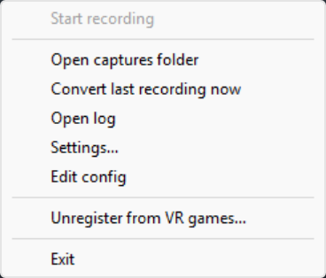
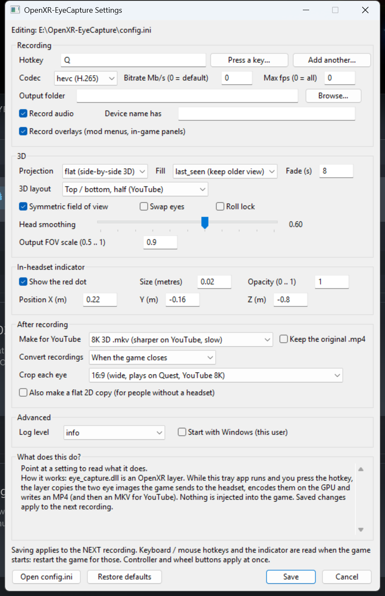

> [!CAUTION]
> ## THIS GITHUB PAGE IS THE ONLY PLACE THIS TOOL EXISTS
> **`https://github.com/JRDevo/OpenXR-EyeCapture` is the only source of truth for this tool: the only place it is
> published, the only place it is documented, and the only place to download it (its [Releases](https://github.com/JRDevo/OpenXR-EyeCapture/releases) page).**
>
> - There is **no website** for this tool. There **never will be** one. No Discord, no Patreon, no Nexus, no Steam Workshop, no app store.
> - **DO NOT DOWNLOAD THIS TOOL FROM ANYWHERE ELSE.** Any other site, mirror, "launcher", "installer", video link or forum attachment that
>   offers it is not mine and may carry anything. If it did not come from this GitHub page, do not run it.
> - Updates, release notes, the hotkey and settings reference and the troubleshooting guide live here and only here. If someone tells you
>   to get the tool somewhere else, they are wrong.

# OpenXR-EyeCapture — stereo recorder for any OpenXR game

Records **both eye images** of an OpenXR game, at exactly the resolution and quality the headset receives, into a
**side-by-side (left | right) 3D MP4** with the game's audio. Press a hotkey (or use the tray icon) to start and stop.
The MP4 carries the standard stereo flag (`st3d`, left-right) for 3D players; for YouTube the tray app also converts every
recording to a `.mkv` with the Matroska stereo tag, which YouTube reliably recognises as 3D (see "Upload to YouTube").

It is an **OpenXR API layer**: it sits between the game and the OpenXR runtime, so it works the same with
Virtual Desktop (VDXR), SteamVR, Oculus / Meta Link, or any other runtime. Nothing is injected into the game and no
game files are touched.

First tested target: **Euro Truck Simulator 2 / American Truck Simulator** (OpenXR beta, Direct3D 11) on Virtual
Desktop. Any other OpenXR game that renders with Direct3D 11 or Direct3D 12 should work the same way.

**Menu:** [Features](#features) · [What it looks like](#what-it-looks-like) · [Download](#-download) · [Requirements](#requirements) · [Install](#install) · [How it works](#how-it-works-start-the-tray-app-first) · [Record](#record) · [YouTube](#upload-to-youtube) · [Settings](#settings--configini) · [Indicator](#in-headset-indicator) · [Smoothing](#head-motion-smoothing) · [Dome mode](#vr180--vr360-dome-mode-experimental) · [Troubleshooting](#log-and-troubleshooting) · [Cost](#cost) · [With other mods](#with-other-mods) · [Build](#building-from-source) · [Report a problem](#reporting-a-problem-what-to-upload) · [License](#license-and-credits)

## Features

- **Both eyes, exact quality** — records each eye at the exact resolution and quality the headset receives, into a
  side-by-side 3D MP4 with the game's audio.
- **OpenXR API layer** — works with any runtime (Virtual Desktop VDXR, SteamVR, Oculus / Meta Link); nothing is injected
  and no game files are touched.
- **Direct3D 11 and 12 games** — any OpenXR game that renders with either.
- **One hotkey** — default `Ctrl+Shift+F10`, or the tray icon, starts and stops a recording; beeps in the headset confirm.
  It can be any key, a mouse side button, an Xbox controller button or a wheel / joystick button (or several of them).
- **Tray app with a Settings window** — every option has a help text, no `config.ini` editing needed.
- **One-click registration** — the tray registers the layer for you (one UAC prompt); **Register** / **Unregister** are in its menu.
- **Tray menu** — Start / Stop recording, Open captures folder, Convert last recording now, Settings..., Open log,
  Edit config, Register for VR games... / Unregister from VR games..., Exit.
- **Tray icon colours** — grey, green, red, amber, blue; the tooltip shows game, resolution, fps, dropped frames and elapsed time.
- **Start with Windows** — optional, off by default (Settings window → Advanced).
- **Command line** — `--start | --stop | --toggle | --status` for scripts and Stream Deck buttons.
- **Automatic MKV conversion** — with the Matroska 3D tag that YouTube recognises. By default it waits until the game has
  closed, so converting never costs frame rate while you play (`post_when`: right away / when VR stops / when the game closes).
- **Optional 8K YouTube copy** (`post_yt8k`) — a far sharper 3D picture on YouTube.
- **Optional flat 2D copy** (`post_flat`) — for viewers without a headset.
- **Head-motion smoothing and symmetric view** — for comfortable 3D.
- **In-headset recording dot** — never appears in the video.
- **Records overlay panels too** (`record_overlays`, on by default) — menus and mod panels the game shows as separate
  OpenXR layers (e.g. the DLAA injector's VR panel and fps box) are placed and blended into the video the way the headset
  shows them. The headset's own menus (Virtual Desktop, Quest) cannot be recorded.
- **VR180 / VR360 dome mode** — experimental.
- **Config changes apply to the next recording** — no game restart.
- **Hardware HEVC encoding** — NVIDIA GTX 10xx or newer, AMD RX 400 or newer, Intel 7th gen or newer.
- **Dormant unless the tray runs** — the layer does nothing while the tray app is not running.
- **Works alongside the [ETS2 / ATS DLAA + DLSS injector mod](https://github.com/JRDevo/ETS2-ATS-DLAA-DLSS-Injection-Mod)**.
- **Log for bug reports** — `logs\eye_capture.log` and `logs\tray.log`.

## What it looks like

Everything runs from one small icon in the Windows tray (next to the clock). The icon colour tells you the state:
**grey** = no VR game running, **green** = game running and ready, **red** = recording, **amber** = starting, finishing
the file or an error, **blue** = converting a finished recording. Hover the icon for the details (game, resolution,
fps, dropped frames, recording time, conversion progress).

### The tray menu (right-click the icon)

| Item | What it does |
|---|---|
| **Start recording** / **Stop recording** | Starts or stops a recording in the running VR game. Same as your hotkey (shown next to it). Greyed out while no game is running. |
| **Open captures folder** | Opens the folder with your recordings (`captures\` unless you set another one). |
| **Convert last recording now** | Converts the newest recording at once (the YouTube `.mkv`, the 8K copy, the flat copy, whatever you switched on), even if conversion is set to wait until the game closes. |
| **Open log** | Opens the recorder's log, `logs\eye_capture.log` (the tray's own log is `logs\tray.log` next to it). Useful when something does not work, and for bug reports. |
| **Settings...** | Opens the Settings window (below). |
| **Edit config** | Opens `config.ini` in Notepad, for the few keys the window does not show. |
| **Register for VR games...** / **Unregister from VR games...** | Tells Windows that VR games may load the recorder (one administrator prompt), or removes that again. Needed once. |
| **Exit** | Closes the tray app. Games started after that are not recorded. A conversion that is still waiting is dropped; the MP4 stays. |

### The Settings window (tray menu -> Settings...)

Point at any setting and the **"What does this do?"** box at the bottom explains it. **Save** applies to the next recording.

| Part | What is in it |
|---|---|
| **Recording** | **Hotkey**: the key that starts / stops a recording. "Press a key..." records a key, mouse button, Xbox controller button or wheel button for you; "Add another..." adds a second one. **Codec** (HEVC = best), **Bitrate** (0 = automatic), **Max fps** (0 = the game's own rate), **Output folder**, **Record audio** (and which audio device), **Record overlays** (mod menus and in-game panels in the video). |
| **3D** | **Projection**: flat side-by-side 3D (normal) or the experimental VR180 / VR360 dome. **3D layout**: how the two eyes are packed for YouTube (top / bottom half is what YouTube likes). **Fill** and **Fade**: dome mode only. **Symmetric field of view**: lines both eyes up so the 3D is comfortable (leave on). **Swap eyes**: if left and right look swapped. **Roll lock**: keeps the horizon level. **Head smoothing**: calms small head shakes (0 = off). **Output FOV scale**: zooms in a little to hide the edges. |
| **In-headset indicator** | A small red dot that you see in the headset while recording, never in the video. Size, opacity and where it floats. |
| **After recording** | **Make for YouTube**: the plain 3D `.mkv` or the sharper 8K `.mkv` (slower to make). **Keep the original .mp4**. **Convert recordings**: right away, when VR stops, or when the game closes (so it does not cost frame rate while you play). **Crop each eye**: 16:9 (wide; plays in the Quest YouTube app and gets 8K), 4:3 (taller view) or none (full view, but tall videos may crash the Quest YouTube player). **Also make a flat 2D copy** for people without a headset. |
| **Advanced** | **Log level** (how much goes into the log) and **Start with Windows** (starts the tray app when you log in). |
| Buttons | **Open config.ini**, **Restore defaults** (fills in the defaults, nothing saved until Save), **Save**, **Cancel**. |

## ⬇ Download

**[Download the latest release here](https://github.com/JRDevo/OpenXR-EyeCapture/releases/latest)**
— get `OpenXR-EyeCapture-v<version>.zip` under **Assets**, then follow [Install](#install) below.
(The green **Code** button downloads the source code, not the tool.) To build it yourself, see "Building from source".

This is an unofficial fan project. It is not affiliated with, or endorsed by, SCS Software, The Khronos Group, Meta,
Valve or Virtual Desktop Inc. Euro Truck Simulator 2 and American Truck Simulator are trademarks of SCS Software;
OpenXR is a trademark of The Khronos Group.

## Requirements

- Windows 10 (1703 or newer) or Windows 11, 64-bit.
- An OpenXR game using **Direct3D 11 or Direct3D 12**. Vulkan is planned ([`docs/VULKAN.md`](docs/VULKAN.md));
  OpenGL is not supported. Unsupported games run normally, just without recording.
- A GPU with a hardware HEVC (H.265) encoder: NVIDIA GTX 10xx or newer, AMD RX 400 or newer, Intel 7th gen or newer.
  HEVC is needed for wide frames: a Quest 3 at high settings is about 6000 x 3200 side by side, beyond H.264 limits.

## Install

1. Unzip `OpenXR-EyeCapture-v<version>.zip` to a folder you keep (the layer is loaded from there), for example
   `C:\Tools\OpenXR-EyeCapture`.
2. Run `EyeCaptureTray.exe`. The first time it asks *"OpenXR-EyeCapture is not registered for VR games yet. Register it
   now?"*: click **Yes** and accept the one Windows administrator (UAC) prompt. That registers the layer for all OpenXR
   apps: `HKLM\SOFTWARE\Khronos\OpenXR\1\ApiLayers\Implicit\<folder>\XR_APILAYER_JRDEVO_eye_capture.json = 0`
   (any older registration from another folder is replaced). Clicked No? Right-click the tray icon →
   **Register for VR games...** whenever you are ready; until then the tooltip says "Not registered for VR games".
   Moved the folder? Start the tray from the new folder and it offers to re-register from there.
3. Optional: tick **Start with Windows** in Settings... → Advanced so the tray app always runs (it must run before the
   game, see "How it works"). This writes one Run entry for your Windows account (`HKCU\Software\Microsoft\Windows\CurrentVersion\Run`,
   value `OpenXR-EyeCapture`).

Uninstall: untick **Start with Windows** in Settings first (or delete that Run value), then right-click the tray icon →
**Unregister from VR games...** (one UAC prompt), exit the tray app and delete
the folder (recordings in `captures\` stay until you delete them).

Command-line forms (from an administrator prompt): `EyeCaptureTray.exe --register` / `--unregister` (exit code 0 = done,
5 = no administrator rights); `EyeCaptureTray.exe --status` prints `registered=yes|no|stale` and `autostart=yes|no` among the status fields.
`scripts\install.ps1` / `uninstall.ps1` are only for building from source (see [`docs/DEVELOPMENT.md`](docs/DEVELOPMENT.md)).

## How it works: start the tray app first

**Start `EyeCaptureTray.exe` before launching the game. Without it the layer does nothing** (it is dormant: every
OpenXR call is passed straight through, no hotkey, no recorder, no encoder, no shared memory). While the tray app runs it
holds a small marker object (`Local\OpenXR-EyeCapture-TrayAlive`); the layer looks for it when the game creates its VR
session and arms itself only if it is there. The decision is made once per session, so starting the tray after the game
is already in VR does not arm it: restart the game (or its VR session). Closing the tray while a game is already armed
does not stop the layer; the hotkey keeps working until the game ends.
Set `require_tray = 0` in `config.ini` to always arm without the tray (old behaviour, hotkey only).
The tray app also owns the registration: at start it checks that the layer is registered for its own folder (and removes
any per-user HKCU copy, which would make some loaders load the layer twice) and offers to register it if not.

## Record

1. Start `EyeCaptureTray.exe`, then the game in VR as usual (ETS2 / ATS: launch option `-openxr`).
2. Press **Ctrl+Shift+F10** → one beep (880 Hz) in the headset: recording.
3. Press **Ctrl+Shift+F10** again → two beeps: stopped, the MP4 is finalized.
   One long low beep = it could not start (see the log).
4. The file lands in the `captures` folder next to `eye_capture.dll`, named
   `<game exe>_<yyyyMMdd_HHmmss>_SBS.mp4`, e.g. `eurotrucks2_20261009_201512_SBS.mp4` (`_VR180.mp4` / `_VR360.mp4` in
   dome mode, see "VR180 / VR360 dome mode").

Recording also stops and the file is finalized when the game closes its VR session (quitting the game normally).
If the game crashes or is killed while recording, the MP4 is lost (it is only finalized at the end).

**Tray icon**: grey = no VR game, green = ready, red = recording, amber = starting / finalizing / failed,
blue = converting a finished recording, or recordings waiting to be converted while no game is running (see "Upload to YouTube").
Right-click: Start / Stop recording, Open captures folder, Convert last recording now, Open log, Edit config, Exit. The tooltip shows game,
resolution, fps, dropped frames and elapsed time, and "converting <file> (MKV)..." / "last: <file>.mkv ready". `EyeCaptureTray.exe --start | --stop | --toggle | --status` does the
same from a script or a Stream Deck button (`--start` / `--toggle` print an error if the tray app is not running);
`--status` also prints `registered=yes|no|stale` and `autostart=yes|no`. `EyeCaptureTray.exe --inputs [seconds]` lists the
Xbox controllers and wheels / joysticks the tray can see and, for 15 s (or the given seconds), prints the `hotkey` text of
every button you press.

## Upload to YouTube

**The tray app converts every recording to a `.mkv` automatically; upload the `.mkv`.** YouTube only reliably recognises
the 3D tag as the Matroska `stereo_mode` tag (it ignored the MP4 `st3d` box), so when a recording is saved
the tray (it must be running, which it is anyway for the layer to be active) writes the `.mkv` with ffmpeg. The recording
itself is always a full side-by-side MP4; the **3D layout** (`layout_3d`, Settings: "3D layout" in the 3D group) decides what
the `.mkv` contains. YouTube only handles `tb_half` correctly (it reads every 3D upload as half-format), so that is the
default: the `.mkv` is **re-encoded** (NVENC HEVC 150 Mbit/s, x265 without NVENC; same frame rate, at most 8192 on the long
side, no upscaling) with each eye squeezed to half height, left eye on top, tagged `top_bottom`. With `layout_3d = sbs_full`
the `.mkv` is the plain fast remux of the recording (`left_right`, no re-encode, takes seconds, the picture is untouched).
YouTube then processes it as a 3D video; viewers in a headset (YouTube VR) get 3D.
Processing of large files takes a while; the 3D version can appear later than the first standard-definition version.

- **When** it converts is `post_when` (Settings: "Convert recordings" under After recording). Converting re-encodes on the
  GPU / CPU, so during a game it can cost frame rate:
  - `game_exit` (default, "When the game closes"): the recording waits until the game that made it has exited and no VR
    game is running. The tooltip says "1 recording waiting -- converts when the game closes".
  - `session_end` ("When VR stops"): waits until no game has a VR session open (the game left VR or closed). If a VR
    session starts while a conversion runs, that ffmpeg is paused (suspended) and continues when VR stops
    ("conversion paused: <file> -- resumes when VR stops").
  - `now` ("Right away"): as soon as the recording is saved.
  **Tray menu > Convert last recording now** always starts at once, whatever `post_when` says. Exiting the tray cancels a
  waiting or paused conversion (the MP4 stays; use "Convert last recording now" later).
- While it runs the tray icon is **blue** and the tooltip says "converting <file> (MKV)..."; afterwards the tooltip says
  "last: <file>.mkv ready" and a balloon says "Ready for YouTube: <file>.mkv". One recording at a time, in order.
- The MP4 is deleted only after the MKV is verified (`keep_mp4 = 1` keeps both): a remux must exist and be larger than 90%
  of the MP4; a re-encoded `.mkv` must exist, not be empty and (with `ffprobe`, which ships next to ffmpeg) have the MP4's
  duration within 1 s / 2%. If anything
  fails (a balloon shows the first line of ffmpeg's error) the MP4 is left untouched. **Tray menu > Convert last recording
  now** retries the most recent recording (it needs the MP4, so use `keep_mp4 = 1` if you want to be able to redo it).
- Needs ffmpeg: `winget install Gyan.FFmpeg.Essentials`. The tray finds it on `PATH`, else in the WinGet packages folder, else
  in an `ffmpeg` folder next to the tray app (or set `ffmpeg_path`). Without ffmpeg you get one balloon "ffmpeg not found"
  and the MP4 stays as it is.
- Dome recordings (`_VR180` / `_VR360`): always a plain remux (`layout_3d` does not apply), the MKV keeps the VR180 / 360
  metadata (`stereo_mode` is `top_bottom` for VR360). See "VR180 / VR360 dome mode".
- Only recordings that finish while the tray runs are converted; older ones: `scripts\make_mkv.ps1 <file.mp4>` (the manual
  path, a plain remux, so it ignores `layout_3d`) or "Convert last recording now".
- `post_flat = 1` also writes `<name>_FLAT.mp4` (normal 2D video: left eye, 16:9 centre crop, 3840 wide, NVENC HEVC or x264;
  same as `scripts\make_flat.ps1`) for viewers without a headset. The tray log is `logs\tray.log` (each ffmpeg command line,
  duration and result).
- `post_yt8k = 1` (Settings: "Make for YouTube" including the 8K file) also writes `<name>_YT8K.mkv`: by default a half top-bottom 3D
  file (left eye on top). Each eye keeps its own aspect with the short side at 4320 (long side capped at 8192) and is
  squeezed to half height, so the whole frame has one eye's aspect. YouTube reads 3D uploads as half-format (it takes the
  frame's aspect as one eye's aspect), so the picture is not stretched. Capped to 60 fps, NVENC HEVC 150 Mbit/s (x265
  without NVENC, much slower), tagged `stereo_mode=top_bottom`. YouTube shrinks a 4640 / 5804 wide side-by-side upload to
  its 4K tier (1920 per eye) at a low bitrate; the 8K file keeps the 8K tier and about 3x the bitrate, so the 3D is far
  sharper on a headset. **Upload the `_YT8K.mkv`** instead of the `.mkv`. Flat 3D recordings only (VR180 / VR360 are
  skipped). The balloon names both files ("YouTube 8K: ..."). The 3D layout of this copy is the same
  `layout_3d` as for the `.mkv` (Settings: "3D layout" in the 3D group): `tb_half` (default, YouTube's format), `sbs_half`,
  `sbs_full` or `tb_full`; see the table below.

## Settings — `config.ini`

Next to `eye_capture.dll` (or `%APPDATA%\OpenXR-EyeCapture\config.ini`, which wins if it exists). Read when a game
starts its OpenXR instance, and read again at the start of every recording: edits to the recording and 3D settings
(`output_dir`, `codec`, `bitrate_mbps`, `max_fps`, `max_width`, `gamma`, `swap_eyes`, `record_overlays`, audio, head smoothing / symmetric
fov, the `[dome]` block, `log_level`) apply to the next recording without restarting the game. Only the keyboard /
mouse part of `hotkey`, `require_tray` and the `[indicator]` keys are fixed until the game restarts (the `post_*` keys
and the controller / wheel part of `hotkey` are read by the tray, at once). The log says what changed: `config reloaded for this recording
from <path>: changed bitrate_mbps=20->60, ...`.

### Settings window

Screenshot and a short tour: [What it looks like](#the-settings-window-tray-menu---settings).

Tray menu -> **Settings...** edits the same file (the `%APPDATA%` copy if it exists, else the one next to the tray app;
the path is shown at the top of the window): recording (hotkey with "Press a key..." and "Add another..." buttons that
also take a mouse side button, an Xbox controller button or a wheel / joystick button, codec, bitrate, max fps,
output folder, audio, record overlays), 3D (projection, 3D layout, fill, symmetric fov, swap eyes, roll lock, head-smoothing slider, output fov scale),
the in-headset indicator, what happens after a recording, and an Advanced group with the log level and the **Start with Windows** checkbox
(`require_tray` is a config.ini-only key: the tray is required anyway). **Start with Windows** is a registry entry for your
Windows account (one `Run` value, see Install), not a config.ini key; it is off by default and applied on **Save**. **Save** rewrites only the lines
whose value changed, in place: comments, blank lines, section headers and keys the window does not know stay as they are
(a missing key is added at the end of its section). A value the parser would reject is refused with a message and nothing
is written. After a save the tray tooltip says "settings saved" for 5 s and `logs\tray.log` lists the changed keys. The
change applies to the next recording, no game restart needed; the exceptions are the keyboard / mouse **hotkey**,
**require_tray** and the **indicator** settings, which need a game restart (controller / wheel hotkeys apply at once). "Open config.ini" opens the file, "Restore defaults" fills the window with
the built-in defaults (nothing is written until Save). Every control has a plain-English description: hover it for a tooltip,
or read the "What does this do?" panel at the bottom of the window (it also follows the keyboard focus). The vr180 / vr360
projections are labelled "experimental" in the window.

| Key | Default | Meaning |
|---|---|---|
| `hotkey` | `Ctrl+Shift+F10` | Start / stop. One or more, separated by commas; any of them works. **Keys**: `Ctrl`, `Shift`, `Alt` + `F1`..`F24`, `A`..`Z`, `0`..`9`, `Numpad0`..`9`, `Home`, `End`, `Insert`, `Delete`, `PageUp`, `PageDown`, `Pause`, `ScrollLock`, `CapsLock`, media keys (`MediaPlayPause`, `VolumeUp` ...), punctuation (`Semicolon`, `Comma` ...), any other key as `Key0xNN`; modifiers must match exactly. **Mouse**: `MouseMiddle`, `MouseX1`, `MouseX2`. Keys and mouse buttons are read when the game starts. **Xbox controller**: `Pad:A`, `Pad:Back+Start` (hold both), `Pad2:LB` (2nd pad only). **Wheel / joystick**: `Joy:*:Button3` (any device), `Joy:T300RS:Button5+Button6` (device name contains `T300RS`), `POVUp` / `POVDown` / `POVLeft` / `POVRight` for the hat. Controller and wheel buttons are read by the tray and apply at once. `EyeCaptureTray.exe --inputs` lists your devices and prints the name of each button you press. `none` = tray only. Example: `ScrollLock, Pad:Back+Start`. |
| `output_dir` | *(empty)* = `captures` next to the DLL | Where MP4s go. |
| `codec` | `hevc` | `hevc` or `h264` (H.264 is limited to 4096 px wide; wider frames are scaled down). |
| `bitrate_mbps` | `0` = 120 (HEVC) / 80 (H.264) | Video bitrate. |
| `fps` | `90` | Fallback frame rate if it cannot be measured (it normally is: the game's real frame rate). |
| `max_fps` | `0` | 0 = every frame the game renders; e.g. `60` drops frames above 60 fps. |
| `max_width` | `0` | 0 = native resolution; otherwise the side-by-side frame is scaled down to this width. |
| `gamma` | `auto` | `auto` from the swapchain format; `srgb` / `linear` only if colours look washed out or too dark. |
| `audio_enabled` | `1` | Record the sound (what plays on the playback device). |
| `audio_device` | *(empty)* = default playback device | Part of the device name, e.g. `Virtual Desktop Audio`. |
| `record_overlays` | `1` | `[capture]`: also record the game's / other mods' overlay layers (OpenXR quad, cylinder, equirect and cube layers: menus, the DLAA injector's VR panel and fps box, panoramas), composited into each eye where and how the headset shows them. `0` = only the game's 3D view. See "Overlays in the recording". |
| `vr_indicator` | `1` | Small recording dot in the headset (never in the video). See "In-headset indicator". |
| `indicator_x` / `_y` / `_z` | `0.22` / `-0.16` / `-0.8` | Dot position in metres relative to your head (right / up / forward is negative z). |
| `indicator_size` | `0.02` | Dot size in metres, `0.0005` .. `0.5` (below about `0.001` it is smaller than one headset pixel). |
| `indicator_opacity` | `1.0` | Maximum opacity of the dot (0..1). |
| `symmetric_fov` | `1` | Re-project both eyes to one common symmetric view (standard 3D SBS). See "Why the eyes are re-projected to a symmetric view". `0` = raw eye images. |
| `head_smoothing` | `0` | Head-motion smoothing strength, `0` = off. See "Head-motion smoothing". |
| `head_follow_deg` | `12` | Smoothing: how far (degrees) the view may lag a deliberate turn before it catches up. |
| `roll_lock` | `0` | Smoothing: `1` = keep the horizon level. |
| `output_fov_scale` | `0.9` | Smoothing: fraction of the game's field of view in the recording (room for the correction). |
| `edge_guard` | `1` | Smoothing: `1` = never show black edges (the correction is limited to what the game rendered). |
| `projection`, `dome_width`, `dome_forward`, `fill`, `fill_fade_s`, `window_feather_deg` | | `[dome]`: VR180 / VR360 output, see "VR180 / VR360 dome mode". |
| `post_mkv` | `1` | Tray app: after each recording, write `<name>.mkv` with the Matroska 3D tag (what YouTube reads): a plain remux with `layout_3d = sbs_full` (and for VR180 / VR360), otherwise a re-encode in the `layout_3d` layout at the recording's own size, same frame rate. |
| `keep_mp4` | `0` | Tray app: `0` = delete the MP4 once the MKV (and the flat / 8K files, if requested) is verified (remux: exists and > 90% of the MP4; re-encode: exists, not empty, duration within 1 s / 2% of the MP4's); `1` = keep both. |
| `post_flat` | `0` | Tray app: also write `<name>_FLAT.mp4`, a normal 2D video (left eye, 16:9 centre crop, 3840 wide). |
| `post_yt8k` | `0` | Tray app: also write `<name>_YT8K.mkv`, a half top-bottom 3D copy for YouTube (each eye keeps its aspect, short side 4320, squeezed to half height; YouTube reads 3D as half-format, so it is not stretched), capped to 60 fps, NVENC HEVC 150 Mbit/s. YouTube then keeps its 8K tier and bitrate (a 4640 / 5804 wide file lands in the 4K tier, 1920 per eye). Upload the `_YT8K.mkv`. Flat 3D recordings only. |
| `layout_3d` | `tb_half` | Tray app, `[dome]` section next to `projection`: 3D layout of the files made from a FLAT recording: the `.mkv` and the `_YT8K.mkv` (the recording itself always stays full side by side; VR180 / VR360 have fixed layouts and ignore it). Left eye first, both eyes identical geometry, `stereo_mode` tag written. `tb_half` = top-bottom, half: frame = one eye's aspect, each eye squeezed to half height (YouTube's format; `top_bottom`). `sbs_half` = side by side, half: each eye squeezed to half width (`left_right`). `sbs_full` = side by side, full: each eye at its own aspect, frame = 2x eye aspect (`left_right`; YouTube shows it stretched, for headset players / 3D TVs; the `.mkv` is then the plain remux). `tb_full` = top-bottom, full: each eye at its own aspect, frame = eye aspect / 2 (`top_bottom`). Every layout except `sbs_full` makes the `.mkv` a re-encode at its native size (long side capped at 8192, source frame rate kept; slower than a remux); the `_YT8K.mkv` has short side 4320. Unknown value: warning in the log, `tb_half`. |
| `eye_crop` | `16:9` | Tray app, `[post_processing]`: before the `.mkv` / `_YT8K.mkv` is made from a FLAT recording, centre-crop each eye vertically (same cut for both, never stretched) to this aspect when the eye is taller: `16:9` (default; 8K frame 7680x4320, plays on the Quest YouTube player and gets YouTube's 8K tier), `4:3` (5760x4320 for 8K) or `none` (full eye; a tall top-bottom video can crash the Quest YouTube player and YouTube caps it at 2160p). An eye already wider than the aspect is not cropped. With a crop, `layout_3d = sbs_full` is re-encoded too (only `sbs_full` + `none` is the plain remux). Settings: "Crop each eye" in the After recording group. Unknown value: warning in the log, `16:9`. |
| `post_when` | `game_exit` | Tray app: when a finished recording is converted. `now` = right away; `session_end` = once no OpenXR session is live (a running conversion is paused while a VR session is live and resumed afterwards); `game_exit` = once the game process that made it has exited and no OpenXR game is live. "Convert last recording now" always runs at once. Re-read when `config.ini` changes (no tray restart). |
| `ffmpeg_path` | *(empty)* = auto | Tray app: full path of `ffmpeg.exe`. Empty = `PATH`, then WinGet packages, then an `ffmpeg` folder next to the tray app. |
| `require_tray` | `1` | `1` = the layer is only active while `EyeCaptureTray.exe` is running (checked when the game creates its VR session). `0` = always active. |
| `log_level` | `info` | `none` (no logging at all), `error`, `warn`, `info`, `debug`. |

## In-headset indicator

While a recording runs you see a small dot at the lower right of your view, in the headset only: **amber** while the
recording starts (and while it is being finished), **red, pulsing** while recording, **green** for 1.5 s when the file
was saved, a **red X** for 2 s if it failed. Otherwise nothing is shown and nothing is done. The dot is a separate
OpenXR layer that the layer adds after it has copied the game's eye images, so it never appears in the video (also not
with `record_overlays = 1`: only the layers the game and other mods submit are recorded, see below).
Settings in `config.ini` `[indicator]`: `vr_indicator = 0` turns it off; `indicator_x/y/z` move it (metres, relative
to your head), `indicator_size` and `indicator_opacity` change size and maximum opacity. The Settings window has fields
for all of them (Position X / Y / Z, Size, Opacity). Direct3D 11 games (ETS2 / ATS)
only for now; on Direct3D 12 the log says `indicator: not available on D3D12 yet` and recording works as before.
If the runtime ever rejects the extra layer, the indicator switches itself off for the session and the game's frame is
submitted unchanged (logged).

## Overlays in the recording

Games and mods can show menus, panels and backdrops as separate OpenXR layers on top of (or behind) the 3D view
("quad", "cylinder", "equirect" and "cube" layers), which the headset composites itself. With `record_overlays = 1` (default; Settings window: **Record
overlays**) the recorder composites those layers into its copy of each eye, at the place, size and transparency the
headset shows them: world-fixed panels stay put, head-locked ones (like the DLAA injector's fps box) stay fixed in the
view, each eye gets its own perspective so the panel is in 3D at the right depth. Symmetric fov, head smoothing and the
VR180 / VR360 dome then treat them like the rest of the picture. The game's own images are never changed.

- What is recorded (up to 16 layers per frame, in the order the game submits them, both eyes or one eye as the layer
  says, alpha blended in linear light like a runtime, Direct3D 11 and 12 games):
  - quad and cylinder panels;
  - equirect (360 / 180 panoramas, both versions of the extension, on a sphere of the given radius or infinitely far)
    and cube (skybox) layers;
  - multisampled (MSAA) panel images, and panels in 8-bit (sRGB or not), 10-bit, 16-bit float and R11G11B10 float
    formats, mixed freely in one recording;
  - the colour scale / bias a layer asks for (`XR_KHR_composition_layer_color_scale_bias`);
  - layers submitted BEHIND the 3D view: they show through where the game's 3D view is transparent (only when the 3D
    view is submitted with source alpha; an opaque 3D view hides them, as in the headset -- logged, nothing drawn).
- What is not recorded: the headset's own menus and boundaries (Virtual Desktop, Quest / SteamVR system UI, guardian)
  -- the headset adds those after the game, so no OpenXR layer can see them; our own red dot; passthrough layers (the
  camera picture never reaches the game) and other layer types (logged by name); a second 3D view; colour scale / bias
  on the 3D view itself; the inverted-alpha flag; Vulkan / OpenGL games.
- The log lists once per game session which overlay layers were found and recorded or why one was skipped
  (`overlay: layer 2 (quad) RECORDED: ...`), and each recording ends with an `overlay summary:` line.
- Cost: nothing while no overlay is shown. With overlays: a copy of each panel image next to the eye copy (on the game's
  GPU queue), one small draw per panel and eye on the encoder's device (a full-eye draw for an equirect / cube layer
  or when layers are behind the 3D view), and VRAM for the panel images while recording: about 64 MB per ring slot
  (192 MB) for each pixel format family in use (twice that for 16-bit float panels).

## Head-motion smoothing

A recording shows exactly where your head pointed, so every small shake and nod is in the video. Viewers who watch it
on a flat screen or in their own headset do not move with you, and the shaking is tiring to watch. With
`head_smoothing` set, the recorder re-projects each eye image onto a smoothed head orientation, the way a headset's
timewarp re-projects a frame: small fast movements are removed, slow and deliberate ones are kept. Only the
recording is affected; the game and your headset view are untouched, and nothing extra runs on the game's thread (the
work is done on the encoder's own GPU device, after the frame is copied).

- **`head_smoothing`** (0 = off, the default): strength. **0.5 to 0.7 is recommended**; 0.6 removes roughly 80 to 85 % of
  a 3 to 5 Hz shake. Higher values make the camera feel heavier.
- **`head_follow_deg`** (default 12): when you deliberately look somewhere else (a mirror, a junction), the smoothed
  view follows as soon as it is this many degrees behind and then catches up quickly, so it does not drift after you.
- **`roll_lock`** (default 0): `1` keeps the horizon level by removing head tilt from the recording.
- **`output_fov_scale`** (default 0.9): the recording shows 90 % of the game's field of view (a slight zoom, the
  outer border is trimmed). That border is the room the correction needs: rotating the view would otherwise show the
  black area outside what the game rendered. Lower it (e.g. 0.85) for stronger smoothing with fewer limits; 1.0 trims
  nothing but leaves no room. Only used while smoothing is on.
- **`edge_guard`** (default 1): never show black edges. When a correction would reach past the rendered image (big
  shakes, the start of a fast turn, `roll_lock` with a tilted head) the view follows your head just enough to stay
  inside it. `0` applies the full correction and lets black edges appear.

Only rotation is smoothed; small position shakes are not visible at normal viewing distances and cannot be
re-projected without depth. If a game submits its views in a head-locked space, there is nothing to smooth (the log
line `re-projection summary` then shows a correction of 0). The summary line per recording shows the mean / max
correction, how often the edge guard limited it, frames with black edges, and the GPU cost.

### Why the eyes are re-projected to a symmetric view

A headset renders each eye with an asymmetric field of view: the outer side is wider than the inner side (for example
-50 / +40 degrees for the left eye and -40 / +50 for the right). The headset's compositor knows that and shows each
image at the right place. A 3D side-by-side player (YouTube VR, a 3D TV) does not: it puts both halves on the same
rectangle, so a far-away object appears at different positions in the two eyes, as if it were closer than infinity or
"beyond" it. The eyes try to fuse that and cannot -- eye strain, double images. Standard 3D video needs two parallel
cameras with identical symmetric fields of view.

With `symmetric_fov = 1` (the default) the recorder therefore re-projects both eyes (on the encoder's GPU device, the
same pass as head smoothing) to the part of the view both eyes share, symmetric and identical for both (in the example
+-40 degrees horizontally), facing the same direction. Eye positions are kept, so the 3D depth is unchanged. The video
is a little narrower than the raw eye images (it keeps the game's pixel density, e.g. 5058 instead of 6120 pixels per
eye for a -50 / +40 view) and costs one GPU pass per frame. `symmetric_fov = 0` records the raw eye images as before.
The log shows the numbers at the start of each recording, e.g.
`symmetric fov: source L[-50.0,+40.0]x[-45.0,+45.0] R[-40.0,+50.0]x[-45.0,+45.0] -> output ±40.0° x ±45.0° per eye, 5058x6496 per eye`.

## VR180 / VR360 dome mode (experimental)

**Experimental:** the dome only shows live video where your headset looked (about 100 degrees); the rest is older video or black.

`[dome] projection = vr180` (or `vr360`) records a **VR180 (or 360) 3D video** instead of a flat side-by-side one: in
YouTube VR the viewer is placed *inside* the scene and can look around, instead of watching a rectangle that follows
your head.

**Mental model: the dome is a world-locked canvas; only what you looked at is painted; stale areas fade.** At the start
of a recording the recorder fixes a "dome" around you, facing the way your head pointed (level with the horizon). Every
frame, each eye's image is painted onto that dome at the place it was actually looking. Your head moving does not move
the picture (head shake simply disappears), and when you look left the left part of the dome gets painted. What you
looked at earlier stays visible (`fill = last_seen`) until it is older than `fill_fade_s` seconds, then fades to black
over 2 s; areas you never looked at are black. The live view always has the game's full resolution and the stereo of
the two eyes (each eye's dome is centred on that eye, like a VR180 camera).

- **Layout.** VR180: two square half-spheres (180 x 180 degrees), left eye left, right eye right. VR360: two 2:1 full
  spheres, left eye on top, right eye below (what YouTube's 360 3D expects).
- **Size.** By default each eye's dome gets the game's own pixel density at the image centre, limited to an 8192 frame:
  ETS2 / ATS on a Quest 3 (3072 x 3264 per eye) would need about 4750 px per eye for VR180, so it is capped at 4096 (frame
  8192 x 4096); VR360 is capped at 8192 x 8192. `dome_width` sets the per-eye width yourself. The log line
  `recorder: dome vr180: source density ... -> ... px per eye, clamped to ...` shows what was chosen.
- **What it ignores.** `symmetric_fov`, `head_smoothing` and its settings are not used in dome mode (not needed: the dome
  is world-locked). `swap_eyes` still works.
- **Which games suit it.** Seated games where the world around you matters and you mostly look forward: driving and flight
  sims, cockpit games (ETS2 / ATS fit well). Fast games where you whip your head around show a lot of half-faded
  dome; `fill = black` shows only the live view.
- **Limits.** The video only contains what you looked at. Rotation only: if you lean far forward the painted areas from
  before do not line up perfectly with the live view (small seams). The horizon is levelled from the play space
  (LOCAL / STAGE), and the dome faces where you looked at the first frame of the recording (`dome_forward = start`).
  VR360 frames are big (8192 x 8192 HEVC at most); the dome needs extra VRAM (the output plus two colour and two time
  copies of the dome: ~640 MB at 8192 x 4096, ~1.3 GB at 8192 x 8192; `fill = black` needs only the output).
- **Files and upload.** Files are named `<game>_<time>_VR180.mp4` / `_VR360.mp4`, with a `<same name>.json` next to it
  that tells the tray app what it is. The MP4 carries the Spherical Video V2 boxes (`st3d` + `sv3d`, equirectangular,
  VR180 = left / right cropped to +-90 degrees), and the tray's MKV keeps them (ffmpeg turns `sv3d` into the Matroska
  `Projection` element), so the routine is the same as for flat recordings: **upload the `.mkv`** (balloon "Ready for
  YouTube (VR180): ..."). The MKV route is verified with ffprobe on both files (`tests\run_dome.ps1`); YouTube's own
  processing of these files has not been tried yet -- if YouTube shows it flat, upload the MP4 (`keep_mp4 = 1`) instead,
  which carries the same metadata in the form Google's spatial-media tools write. `post_flat = 1` makes the `_FLAT.mp4`
  from the left eye's view straight ahead (ffmpeg `v360`, 100 degrees wide, 3840 x 2160); `scripts\make_flat.ps1` is
  for side-by-side recordings only.

| Key (`[dome]`) | Default | Meaning |
|---|---|---|
| `projection` | `flat` | `flat` = side-by-side 3D (as before), `vr180`, `vr360`. |
| `dome_width` | `0` | Per-eye width in pixels; `0` = from the game's pixel density (capped at an 8192 frame). |
| `dome_forward` | `start` | The dome faces your head's direction at the start of the recording (only value for now). |
| `fill` | `last_seen` | `last_seen` = keep what you looked at earlier; `black` = only the live view, the rest black. |
| `fill_fade_s` | `8` | Seconds a painted area stays before fading to black (over 2 s); `0` = never fade. |
| `window_feather_deg` | `1` | Soft edge (degrees) where the live view blends into the dome; `0` = hard edge. |

## Log and troubleshooting

`logs\eye_capture.log` next to the DLL, with a copy in the output folder. Every OpenXR app that starts writes a block:
the game exe, runtime, graphics API (`capture AVAILABLE` / `DISABLED`), every swapchain (format, size, array, MSAA),
the frame layout it detected (`TWO_SWAPCHAINS`, `TEXTURE_ARRAY`, `ONE_SWAPCHAIN_TWO_RECTS`), the encoder it picked
(e.g. `NVIDIA HEVC Encoder MFT [hardware]`) and a summary per recording (frames written / dropped, duration, file).

- **Nothing happens on the hotkey**: first make sure `EyeCaptureTray.exe` was running before the game started; if not the
  log says `EyeCaptureTray not running ... layer dormant for this session`. Then check the log has a `session ... created: graphics API D3D11 -> capture AVAILABLE`
  line for the game. No `loaded into <game>.exe` line at all = the layer is not registered (the tray tooltip then says
  "Not registered for VR games": right-click the tray icon → **Register for VR games...**) or the game does not use
  OpenXR. Registration problems are logged in `logs\tray.log` (`tray: registration: ...`, `tray: --register ...`).
  A controller or wheel button: run `EyeCaptureTray.exe --inputs` in a command prompt and press the button; it prints the
  exact text to put in `hotkey` (e.g. `Joy:Thrustmaster T300RS Racing Wheel:Button3`). `logs\tray.log` lists the devices
  the tray sees (`tray: devices: ...`) and every press (`tray: input ... pressed -> toggle`).
- **Dropped frames** in the summary: lower `max_fps` or `max_width`, or `bitrate_mbps`.
- **Disable without uninstalling**: set the environment variable `DISABLE_XR_APILAYER_JRDEVO_eye_capture=1`.

## Cost

Per frame the game's render thread does two GPU copies (plus an MSAA resolve when the game uses MSAA swapchains),
a fence signal and nothing else — measured 0.07 ms (D3D12) / 0.18 ms (D3D11) of CPU time per frame on an RTX 5090.
Encoding runs on its own threads and its own D3D11 device on the same GPU. Extra VRAM while recording: about
3 x the side-by-side frame in RGBA plus 4 x in NV12 (≈ 400 MB at 6144 x 3264). Nothing is done while not recording.
Head-motion smoothing and `symmetric_fov` (on by default) add one more RGBA frame of VRAM and one full-screen pass on
the encoder's device: measured
0.2 ms GPU per frame at 12240 x 6496 (ATS on VDXR, encoded at 8192 x 4346) on an RTX 5090, and nothing on the game's
thread or GPU queue.

## With other mods

- **ETS2 / ATS DLAA + DLSS injector**: works alongside; this layer never hooks Present or the game's D3D calls. The
  default hotkey is Ctrl+**Shift**+F10 because plain Ctrl+F10 is the injector's snapshot key. Its VR panel and fps box
  are OpenXR quad layers that the injector adds in front of every OpenXR layer, so this recorder sees them and, with
  `record_overlays = 1` (default), records them where you see them. Set `record_overlays = 0` for a clean video.
- **Virtual Desktop's own OpenXR layer** and other implicit layers coexist (each registers its own entry).

## Building from source

See [`docs/DEVELOPMENT.md`](docs/DEVELOPMENT.md). Short version: Visual Studio 2022, then
`powershell -ExecutionPolicy Bypass -File scripts\package.ps1`.

## Reporting a problem (what to upload)

If something goes wrong, [open an issue](../../issues/new/choose) on this GitHub page and attach the files below.
Without the logs I usually can't tell what happened.

**Files to attach** — from the tool's folder (next to `eye_capture.dll`):

- **`logs\eye_capture.log`** — **required, always.**
- **`logs\tray.log`** — **required.**
- **`config.ini`** — **required** (your settings).

**Write in the issue:**

- Game, and whether it was started with `-openxr`.
- Headset and runtime (e.g. Quest 3 via Virtual Desktop / VDXR, SteamVR).
- GPU and driver version.
- Windows version.
- Tool version (the name of the zip you downloaded).
- What you pressed and what happened (beeps heard, tray icon colour).
- Other OpenXR layers or mods in use (the DLAA injector, OpenXR Toolkit, etc.).

**Privacy:** the logs contain folder paths with your Windows user name. Open them and check (or edit them) before uploading.

## License and credits

**This tool** — [PolyForm Noncommercial License 1.0.0](LICENSE.md), Copyright (c) 2026 JRDevo (same license as the ETS2 / ATS DLAA + DLSS injector mod).

- Free to use, copy, change and share for **noncommercial** purposes.
- **No commercial use** (no selling, no paid bundles) without written permission.
- If you share it, include the license and the copyright notice.
- No warranty: you use it at your own risk.

**How it was made** -- the ideas, the direction, every test round in the headset and the verdicts are JRDevo's. The code and docs were written by Claude (Anthropic): Claude Fable 5.1 as
the lead, with Claude Opus 5.5, Opus 4.8 and Sonnet 5.5 agents doing the building.
JRDevo gains nothing from this tool except a fixed problem and a shared solution: no money, no donations,
no paid versions. Made with love.

**Third-party parts** — each has its own terms, see [`THIRD_PARTY.md`](THIRD_PARTY.md):

| Part | License | Shipped with this tool? |
|------|---------|-------------------------|
| OpenXR SDK headers (Khronos) | Apache-2.0 | Compiled into `eye_capture.dll` (headers only; the OpenXR loader is not shipped) |
| Windows SDK components (Direct3D 11 / 12, DXGI, Media Foundation, WASAPI) | Part of Windows | Used through the operating system, not redistributed |
| ffmpeg | — | **Not shipped.** You install it yourself (`winget install Gyan.FFmpeg.Essentials`) and the tray app calls it |

Unofficial fan project: not affiliated with, or endorsed by, SCS Software, The Khronos Group, Meta, Valve or Virtual Desktop Inc.
